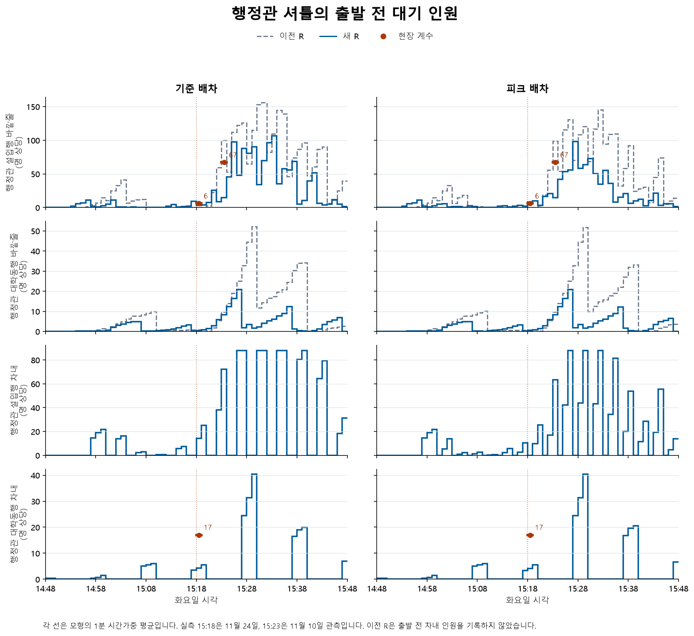

# 행정관 셔틀 대기 예측과 현장 관측 비교

**6건의 바깥줄 관측에서 기준 배차의 평균절대오차는 13.51명에서 13.10명으로 줄었지만, 피크 배차는 13.10명에서 18.75명으로 커졌다.** 15:18 설입행의 개선과 15:23 설입행의 과소예측이 함께 나타났다. 이번 비교 결과는 후보의 전면 교체를 뒷받침하지 않는다.

이전 R261124110718과 새 후보 R261124160531의 검증 완료 원장을 같은 요일·배차로 짝지었다. 시뮬레이션 인원은 학생 집단의 가중치를 합한 명 상당이다. 두 배차는 같은 학생을 대상으로 한 별개 가정이다.

새 R은 약 25%의 강좌가 2~10분(최빈 5분) 일찍 끝나고, 약 25%의 하교 이동이 5~40분(최빈 15분) 추가로 머문 뒤 출발한다고 가정한다. 두 효과는 겹칠 수 있다. 행정관 두 방향 셔틀은 직전 서로 다른 출발시각 간격의 절반과 180초 중 짧은 시간만큼 일찍 문을 연다. 이 숫자는 모형 가정이다.

## 현장에서 센 인원

모형 값은 보고된 1분 동안의 평균 (최소~최대)이다. 각 상태가 실제로 지속된 시간만큼 평균에 반영했다. 괄호는 해당 분의 모형 변동 폭이다. 날짜별 실제 차량의 초 단위 운행은 알려져 있지 않다.

| 날짜·시각 | 위치와 관측 대상 | 실측 | 기준 이전 R | 기준 새 R | 피크 이전 R | 피크 새 R |
|---|---|---:|---:|---:|---:|---:|
| 11/09 16:53 | 행정관 설입행 바깥줄 | 53 | 49.1 (27.5~74.9) | 42.3 (30.1~52.1) | 62.4 (40.8~88.2) | 7.7 (4.0~13.4) |
| 11/09 16:55 | 문화관입구 21297 바깥줄 | 5 | 6.0 (4.6~7.3) | 5.0 (4.0~5.8) | 6.0 (4.6~7.3) | 5.0 (4.0~5.8) |
| 11/09 17:03 | 정문 21128 바깥줄 | 33~39 | 61.4 (53.5~69.6) | 26.8 (23.0~31.1) | 58.9 (53.8~65.5) | 27.1 (22.4~32.4) |
| 11/10 15:23 | 행정관 설입행 바깥줄 | 67 | 100.1 (81.6~108.9) | 14.8 (10.2~22.8) | 98.8 (78.3~109.6) | 14.5 (10.2~18.7) |
| 11/24 13:52 | 행정관 설입행 바깥줄 | 26 | 20.2 (11.8~28.3) | 19.9 (14.2~25.1) | 20.2 (11.8~28.3) | 19.9 (14.2~25.1) |
| 11/24 15:18 | 행정관 설입행 바깥줄 | 6 | 0.0 (0.0~0.0) | 3.0 (0.6~5.8) | 0.0 (0.0~0.0) | 8.2 (5.7~14.0) |
| 11/24 15:18 | 행정관 대학동행 차내 | 17 | 차내 상태 미기록 | 4.3 (3.7~4.9) | 차내 상태 미기록 | 4.1 (3.5~4.9) |
| 11/25 16:00 | 행정관 설입행 바깥줄 | 8 | 18.7 (5.2~29.7) | 11.9 (4.2~17.8) | 18.5 (5.2~29.2) | 11.9 (4.2~17.8) |

문화관은 제보의 정류장 명칭을 21297로 대응했다. 정문은 설입 방면 여러 노선을 함께 기다리는 줄이다. 15:23의 67명은 관측자 포함이다. 15:18 차내 실측 17명은 당시 한 대에 타 있던 인원이다. 새 R에서도 이 1분 동안 대기 중인 해당 방향 차량이 한 대이고, 직전 정류장에서 계속 타고 온 승객이 0명임을 확인했다.

### 11월 25일 수요일 16:00 차가 도착했을 때

행정관 설입행 바깥줄은 8명이었고 제보자는 도착한 차에 바로 탔다. 시간을 초 단위로 재지 않았다. 제보자 포함 여부와 함께 승차한 총원은 미상이다. 이 관측은 도착 직전의 줄과 이어진 승차 순서로 평가한다. 분 안의 임의 시각을 가정하는 종전 6건 오차 평균에서는 별도로 다룬다.

- 기준 배차에서 바깥줄은 평균 11.9 (4.2~17.8)명 상당이다. 그 1분에 새로 문을 연 차량은 0대다. 앞뒤 개문은 15:58:00, 16:02:00이다.
- 피크 배차에서 바깥줄은 평균 11.9 (4.2~17.8)명 상당이다. 그 1분에 새로 문을 연 차량은 0대다. 앞뒤 개문은 15:58:30, 16:01:30이다.

[관측 원문과 현장 확인](../../field_observations_2026-11-25/boarding_admin_snu_1600.json) · [당일 위치 기록을 적용한 재현](../../field_observations_2026-11-25/README.md)

### 15:23에 줄이 얼마나 줄었는지 해석할 때

- 기준 배차의 새 R에서는 분평균 14.8명이 밖에 서 있고 72.3명이 이미 차에 타 있다. 합계 87.1명 상당이 출발을 기다린다.
- 피크 배차의 새 R에서는 분평균 14.5명이 밖에 서 있고 63.3명이 이미 차에 타 있다. 합계 77.8명 상당이 출발을 기다린다.

11월 10일 현장에서는 관측자가 줄에 선 뒤에 두 대가 함께 도착했다. 도착시각은 15:24 이후였다는 대략적인 기억이다. 반면 새 R의 15:24 출발 두 대는 기준 배차에서 15:22:00, 피크에서 15:22:30에 문을 연다. 같은 시간에 정류장에 도달한 학생 수도, 도착한 사람 중 바깥에 남는 비율도 바뀔 수 있다. 실측 67명과 비교할 값은 바깥줄이다. 두 모형의 차이에는 수요 시각 변경과 사전 승차가 함께 작용하므로 두 효과의 기여율은 이 비교만으로 분리하기 어렵다.

## 바깥줄 오차와 전후 30분

직접 계수한 바깥줄 6건에 각각 같은 비중을 주었다. 초가 미상이므로 분 안에서 균일하게 관측했다고 가정하고, 각 순간의 절대오차를 시간가중했다. 33~39명은 해당 범위까지의 거리로 계산했다. 차량 출발 후 잔여, 차내 인원, 개인 대기시간은 이 집계와 별도로 평가했다.

| 배차 | 이전 R 평균절대오차 | 새 R 평균절대오차 | 개선 / 악화 / 동일 |
|---|---:|---:|---:|
| 기준 | 13.51명 | 13.10명 | 5 / 1 / 0 |
| 피크 | 13.10명 | 18.75명 | 4 / 2 / 0 |

먼저 캠퍼스 전체에서 실제로 건물을 나선 모의 하교 인원을 집계했다. 같은 준비 수요를 사용하므로 배차별 출발량이 같다.

| 출발 시간대 (끝 시각 제외) | 이전 R | 새 R |
|---|---:|---:|
| 14:48-15:48 | 3,430.2 | 3,347.4 |
| 15:00-15:16 | 0.0 | 508.1 |
| 15:16-15:19 | 1,488.0 | 967.9 |

| 14:48 이상~15:48 미만 | 배차 | 이전 R 평균 | 새 R 평균 | 이전 R 최고 | 새 R 최고 |
|---|---|---:|---:|---:|---:|
| 행정관 설입행 바깥줄 | 기준 | 40.2 | 20.8 | 161.4 | 117.5 |
| 행정관 설입행 차내 | 기준 | 미산출 | 19.1 | 미산출 | 88.0 |
| 행정관 대학동행 바깥줄 | 기준 | 8.5 | 3.1 | 54.0 | 23.2 |
| 행정관 대학동행 차내 | 기준 | 미산출 | 3.2 | 미산출 | 42.6 |
| 행정관 설입행 바깥줄 | 피크 | 33.0 | 14.6 | 157.3 | 114.3 |
| 행정관 설입행 차내 | 피크 | 미산출 | 15.6 | 미산출 | 88.0 |
| 행정관 대학동행 바깥줄 | 피크 | 8.1 | 3.0 | 52.5 | 23.2 |
| 행정관 대학동행 차내 | 피크 | 미산출 | 3.2 | 미산출 | 42.6 |

시간대 전체에는 연속 현장 계수가 없어 모형끼리 비교했다. 그래프 선은 1분 평균이고, 위 표의 최고는 짧은 구간까지 포함한 순간 최고다. CSV는 1분·5분·한 시간 요약을 담으며 15:48분은 별도 1분 행으로 제공한다.



## 개인 탑승 경험과 차량 출발 직후

11월 10일 15:23 행정관 설입행 관측자는 줄 합류부터 두 번째 차에 타기까지 189초, 탑승 후 출발까지 30초, 합계 219초를 쟀다. 아래는 같은 분에 해당 승차장에 도착해 그곳에서 승차한 모의 집단의 가중 중앙값 (10~90백분위), 단위는 초다. 한 사람의 실측과 같은 사람을 추적한 비교는 할 수 없다. 이전 R은 승차와 출발을 같은 사건으로 처리했다.

| 배차 | 모형 | 비교 집단(명 상당) | 줄 합류→승차 | 승차→출발 | 줄 합류→출발 |
|---|---|---:|---:|---:|---:|
| 기준 | 이전 R | 34.1 | 53 (37~250) | 동시 처리 | 53 (37~250) |
| 기준 | 새 R | 45.4 | 120 (20~139) | 120 (17~120) | 240 (37~259) |
| 피크 | 이전 R | 41.7 | 58 (37~196) | 동시 처리 | 58 (37~196) |
| 피크 | 새 R | 45.4 | 20 (20~106) | 38 (8~90) | 58 (28~196) |

관측자는 함께 온 두 대 중 두 번째 차에 탔다. 15:23에 줄에 섰고 219초 후 출발했으므로 관측 차량의 출발 가능 구간은 15:26:39 이상~15:27:39 미만이다. 실제 차량의 도착 초는 미측정이다.

| 배차 | 이전 R의 해당 구간 출발 | 새 R의 해당 구간 출발 |
|---|---|---|
| 기준 | 0대 | 0대 |
| 피크 | 15:27 2대 | 15:27 2대 |

11월 23일 12:20 행정관 설입행은 줄이 있었고 제보자가 곧바로 탔다. 정확한 인원과 초는 미측정이다. 같은 분에 도착한 뒤 그 정류장에서 셔틀에 탄 모의 집단으로 비교했다.

| 배차 | 모형 | 관측 분 바깥줄 평균 (범위) | 해당 분에 도착해 탄 집단 | 그 분 안에 도착·탑승 완료 | 개인 줄 대기 중앙값 (10~90백분위), 초 |
|---|---|---:|---:|---:|---:|
| 기준 | 이전 R | 1.3 (0.0~4.9) | 4.9 | 0.0 | 551 (551~562) |
| 기준 | 새 R | 7.5 (2.0~14.6) | 12.7 | 0.0 | 382 (371~413) |
| 피크 | 이전 R | 1.3 (0.0~4.9) | 4.9 | 0.0 | 551 (551~562) |
| 피크 | 새 R | 7.5 (2.0~14.6) | 12.7 | 0.0 | 382 (371~413) |

11월 23일 16:59 대학동행은 만차 출발 뒤 바깥에 1명이 남았다. 같은 분에 모형 출발이 없으면 가장 가까운 편에서 출발 단계를 맞춰 비교했다. 현장 차량의 개인별 승차시각과 출발 당시 정확한 탑승 인원은 미측정이다.

| 배차 | 모형 | 모형 출발시각 | 실측 분과 일치 | 차내/정원 | 출발 직후 바깥 전체 | 그중 승차 준비를 마치고 남은 줄 |
|---|---|---|---|---:|---:|---:|
| 기준 | 이전 R | 17:00 | 아니요 | 44.0/44 | 7.4 | 5.6 |
| 기준 | 새 R | 17:00 | 아니요 | 40.3/44 | 0.9 | 0.0 |
| 피크 | 이전 R | 17:00 | 아니요 | 44.0/44 | 6.5 | 5.0 |
| 피크 | 새 R | 17:00 | 아니요 | 40.1/44 | 0.9 | 0.0 |

바깥 전체는 학생별 정류장 도착부터 퇴장까지의 원장에서 해당 출발 처리 직후에 남은 가중 인원이다. 화면용 곡선의 출발 직후 값과도 대조했다. 승차 준비 중인 사람을 포함하므로 차량 사건의 준비 완료 줄과 차이가 생길 수 있다.

## 평일 운행 검증

| 모형 | 평일 기준 배차 하교 합계 | 최장 한 정류장 대기 | 20분 초과 가중 대기 | 정원 위반 | 미완료 이동 |
|---|---:|---:|---:|---:|---:|
| R261124110718 | 78,169.0 | 20.00분 | 0.000 | 0 | 0.000 |
| R261124160531 | 78,169.0 | 19.72분 | 0.000 | 0 | 0.000 |

하교 합계는 5개 요일의 기준 배차에서만 합산했다. 나머지 열은 모형별 10개 실행에서 집계한 내부 검증 지표다. 각 요일의 네 조건에서 하루 하교 인원이 일치했다. 20분은 한 정류장에서 이어진 바깥 대기를 기준으로 한다.

아래는 15~19시 전체 정류장의 바깥 대기 누계(명·분)다. 10명이 3분씩 기다리면 30명·분이다. 차에 미리 타면 출발 전까지 차 안에서 보내는 시간이 생기므로 바깥 대기 감소만으로 귀가가 그만큼 빨라졌다고 해석할 수 없다.

| 요일 | 기준 이전 R | 기준 새 R | 피크 이전 R | 피크 새 R |
|---|---:|---:|---:|---:|
| 월 | 74,379.5 | 61,376.8 | 71,554.5 | 59,453.1 |
| 화 | 72,625.3 | 58,758.4 | 69,597.4 | 56,989.7 |
| 수 | 71,462.7 | 58,486.5 | 67,491.0 | 56,045.4 |
| 목 | 63,928.0 | 51,493.6 | 61,356.3 | 49,220.0 |
| 금 | 12,494.9 | 9,603.3 | 12,148.1 | 9,489.2 |

## 재현과 자료

시간대별 바깥줄의 평균은 개인별 원장의 정류장 체류시간과 가중치로, 차내 평균은 출발 전 승차 기록으로 별도로 검산했다. 관측을 이미 참조해 만든 연구 후보의 비교이므로 새 날짜에 대한 예측 정확도는 추가 관측으로 평가해야 한다.

- [현장 인원 비교 CSV](실측_인원_비교.csv) · [화요일 시간대별 CSV](화요일_시간대별.csv) · [평일 검증 CSV](평일_검증.csv)
- [이전 R 집계와 원본 SHA-256](R261124110718.json) · [새 R 집계와 원본 SHA-256](R261124160531.json)
- [실측 대조 코드](compare.py) · [표와 그래프 생성 코드](publish.py)

같은 폴더에서 Python 3.11 이상으로 아래 명령을 순서대로 실행한다. 그래프 생성에는 Matplotlib와 한글 글꼴 맑은 고딕이 필요하다. 기존 검증 원장만 읽는다.

```powershell
python compare.py --model 261124110718
python compare.py --model 261124160531
python publish.py
```
