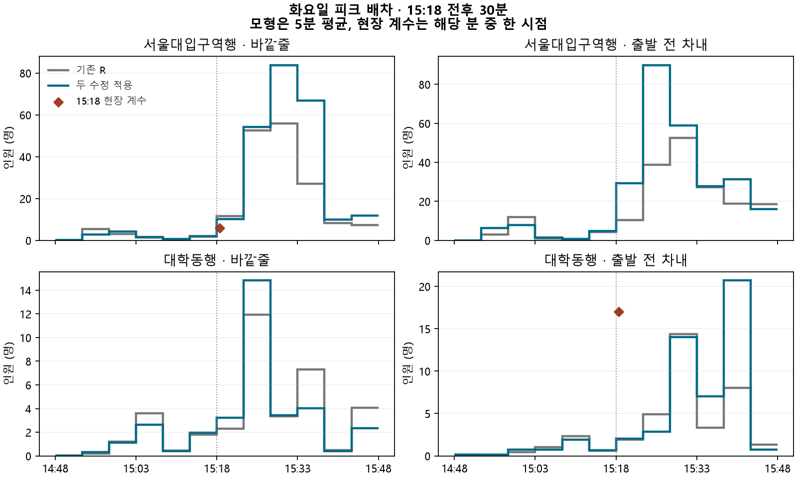

# 행정관 셔틀 복귀·승차와 강좌 종료시각 비교

기존 R261124160531과 R261125164654의 평일 5일 × 2배차를 같은 최초 경로·목적지·통행 집단으로 비교했다. 수치는 모의 인원 상당이다. 네 조건에서 각 요일의 원래 하교 통행량과 학생별 가중치가 일치한다.

## 분 단위 현장 비교

표는 보고된 1분의 시간가중 평균이다. [현장비교.csv](현장비교.csv)에 분 내 최소·최대와 시간가중 절대오차를 함께 기록했다. 차내 관측은 같은 방향에서 한 대만 서 있고 그 차량에 남아 있던 통과 승객이 없을 때 비교했다.

### 기준 배차

| 날짜 | 시각·장소 | 실측 | 기존 R | 차량만 | 출발만 | 두 수정 |
|---|---|---:|---:|---:|---:|---:|
| 11/09 | 16:53 설입행 바깥 | 53 | 42.3 | 8.3 | 46.8 | 11.5 |
| 11/09 | 16:55 문화관 바깥 | 5 | 5.0 | 5.0 | 5.3 | 5.3 |
| 11/09 | 17:03 정문 바깥 | 33~39 | 26.8 | 26.8 | 32.3 | 32.3 |
| 11/10 | 15:23 설입행 바깥 | 67 | 14.8 | 15.0 | 27.0 | 15.0 |
| 11/24 | 13:52 설입행 바깥 | 26 | 19.9 | 20.0 | 20.0 | 20.2 |
| 11/24 | 15:18 설입행 바깥 | 6 | 3.0 | 3.3 | 3.1 | 3.4 |
| 11/24 | 15:18 대학동행 차내 | 17 | 4.3 | 4.3 | 4.5 | 4.4 |
| 11/25 | 16:00 설입행 바깥 | 8 | 11.9 | 5.0 | 7.7 | 4.3 |

바깥줄 일곱 관측의 분 내 절대오차를 같은 비중으로 평균하면 위의 조건 순서대로 11.90명, 16.42명, 9.31명, 15.48명이다.

### 피크 배차

| 날짜 | 시각·장소 | 실측 | 기존 R | 차량만 | 출발만 | 두 수정 |
|---|---|---:|---:|---:|---:|---:|
| 11/09 | 16:53 설입행 바깥 | 53 | 7.7 | 8.1 | 10.8 | 11.5 |
| 11/09 | 16:55 문화관 바깥 | 5 | 5.0 | 5.0 | 5.3 | 5.3 |
| 11/09 | 17:03 정문 바깥 | 33~39 | 27.1 | 27.1 | 32.7 | 32.7 |
| 11/10 | 15:23 설입행 바깥 | 67 | 14.5 | 15.2 | 18.5 | 15.0 |
| 11/24 | 13:52 설입행 바깥 | 26 | 19.9 | 20.0 | 20.0 | 20.2 |
| 11/24 | 15:18 설입행 바깥 | 6 | 8.2 | 3.5 | 8.2 | 3.5 |
| 11/24 | 15:18 대학동행 차내 | 17 | 4.1 | 4.1 | 4.3 | 4.3 |
| 11/25 | 16:00 설입행 바깥 | 8 | 11.9 | 5.1 | 7.7 | 4.3 |

바깥줄 일곱 관측의 분 내 절대오차를 같은 비중으로 평균하면 위의 조건 순서대로 16.74명, 16.35명, 15.11명, 15.47명이다.

## 승차와 차량이 떠난 뒤 남은 줄

11/23 월요일 16:59에 대학동행이 만차로 떠난 뒤 1명이 남았다. 관측 분에 출발 사건이 없는 경우 가장 가까운 편을 표에 표시했다.

| 배차 | 조건 | 비교한 출발 | 차내 / 정원 | 출발 직후 바깥 |
|---|---|---|---:|---:|
| regular | 기존 R | 17:00:00 | 40.3 / 44 | 0.9 |
| regular | 차량만 | 17:00:00 | 40.5 / 44 | 0.9 |
| regular | 출발만 | 17:00:00 | 39.4 / 44 | 1.6 |
| regular | 두 수정 | 17:00:00 | 38.6 / 44 | 1.7 |
| peak | 기존 R | 17:00:00 | 40.1 / 44 | 0.9 |
| peak | 차량만 | 17:00:00 | 40.1 / 44 | 0.9 |
| peak | 출발만 | 17:00:00 | 39.0 / 44 | 1.6 |
| peak | 두 수정 | 17:00:00 | 38.2 / 44 | 1.7 |

아래 표는 해당 분에 승차장에 진입해서 결국 그 줄에서 탑승한 통행 중, 진입 당시 가장 가까운 출발 묶음을 탄 비율이다. 분모가 0이면 비교할 수 없다. 문을 연 채 기다리고 있던 차도 포함한다. 한 제보자의 정확한 대기시간이나 같은 두 번째 버스에 탔는지까지 식별할 수는 없다.

| 날짜·시각 | 배차 | 기존 → 두 수정 | 바깥 대기 중앙값(초) 기존 → 두 수정 | 해당 분 개문 차량 수 (기존 → 두 수정) |
|---|---|---:|---:|---:|
| 11/23 12:20 | regular | 100% (분모 12.7명) → 100% (분모 10.9명) | 382 → 416 | 0 → 0 |
| 11/23 12:20 | peak | 100% (분모 12.7명) → 100% (분모 10.9명) | 382 → 416 | 0 → 0 |
| 11/10 15:23 | regular | 50% (분모 45.4명) → 48% (분모 42.1명) | 120 → 22 | 0 → 0 |
| 11/10 15:23 | peak | 59% (분모 45.4명) → 48% (분모 42.1명) | 20 → 22 | 0 → 0 |
| 11/25 16:00 | regular | 100% (분모 13.7명) → 74% (분모 15.3명) | 98 → 21 | 0 → 0 |
| 11/25 16:00 | peak | 100% (분모 13.7명) → 0% (분모 15.3명) | 68 → 21 | 0 → 0 |

## 15:18 전후 30분

화요일 14:48~15:48의 5분별 유입량과 평균 대기는 [화요일_5분_대기.csv](화요일_5분_대기.csv)에 있다. 전후 구간의 연속 현장 계수는 확보되지 않았다. 차내 열은 그 방향에서 출발을 기다리는 차들의 합이다.

| 배차 | 승차장 | 1시간 유입 기존 → 두 수정 | 평균 바깥줄 기존 → 두 수정 | 평균 차내 기존 → 두 수정 |
|---|---|---:|---:|---:|
| regular | 설입행 | 812.9 → 846.9 | 20.8 → 24.5 | 19.1 → 24.8 |
| regular | 대학동행 | 84.8 → 87.2 | 3.1 → 2.9 | 3.2 → 4.4 |
| peak | 설입행 | 792.6 → 782.6 | 14.6 → 20.7 | 15.6 → 22.9 |
| peak | 대학동행 | 85.2 → 85.4 | 3.0 → 2.9 | 3.2 → 4.3 |

## 평일 전체 검산

두 수정 조건에서 기준 배차 월~금 총 78,169.0명 상당이며, 기준·피크 10조건의 모든 정류장 중 최장 연속 바깥 대기는 20.50분이다. 20분 초과 통행 가중치의 조건별 최댓값은 0.10명이다. 조건별 정원 위반은 최대 0, 미완료는 최대 0.00명이다. 개별 집단의 질량, FIFO 승차 순서, 차량별 승하차·재차, 지도 대기곡선과 개인 대기 원장을 검산했다. [평일검증.csv](평일검증.csv)
