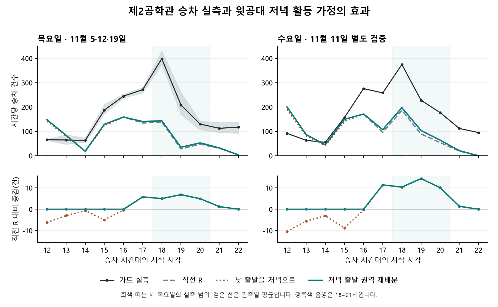

# 윗공대 저녁 활동 수요 실험 R261127174022

18~21시 제2공학관 승차가 부족한 이유를 시험하기 위해 같은 규모의 저녁 통행을 윗공대 낮 통행에서 옮길 때와, 이미 저녁에 일어나던 통행의 출발 권역을 옮길 때를 비교했다. 대조군은 직전 R261127173038의 30~60분 조건이다. 모형을 만들 때 사용한 세 목요일과 새로 확보한 11월 11일 수요일의 승하차를 별도로 채점했다.

**후속 연구에는 윗공대 안에서 낮 출발 일부를 저녁으로 옮기는 조건(within)을 남긴다.** 같은 수의 저녁 활동 통행을 넣으면 출발 권역을 재배분해도 제2공학관의 저녁 승차는 거의 같다. 반면 낮부터 저녁까지 비교하면 within이 두 요일 모두 두 역 방면 오차를 가장 많이 줄였고, 다른 권역에서 수요를 일괄 감액할 필요도 없다. 경로 표본을 나누기만 한 대조군은 18~21시 두 방면 오차가 직전 R과 같았다. 이 판단은 통행 시간 분포에 관한 연구 후보 선택이며, 연구·근무 인구의 규모를 식별한 결과로 사용할 수 없다.

남은 문제는 제1공학관과 역 방면별 차이다. within 조건에서 제1공학관 저녁 오차가 두 요일 모두 증가했다. 수요일 19시대 제2공학관→서울대입구역도 실측 38건에 기존 50.49건, 변경 57.58건으로 과대예측이 커졌다. 다음 보정 때에는 출발 총량을 추가로 키우기 전에, 같은 노선·하차 방면에서 제1공학관과 제2공학관 중 어디서 타는지를 별도 날짜 자료로 검증하는 것이 우선이다.

## 실험 가정

윗공대 300·301·302동의 석박사통합 과정 강좌에서 수업 종료와 기존 모의 출발이 모두 16시 이전이며 신림선 예약 집단에 속하지 않는 통행은 목요일 168.64명, 수요일 315.26명 상당이었다. 그 가중치의 25%(목 42.16명, 수 78.82명)를 시나리오 규모로 삼았다. 새 활동 종료 시각은 17:00 이상 21:00 미만에서 균등하게 배정했다. 수강편람의 과정 구분은 출발 건물·경로의 표본을 얻는 데 사용했다. 실제 대학원생 인구나 연구실 퇴실 시각 분포는 관측되지 않았다.

| 조건 | 기존 통행에서 어떤 부분을 옮겼나 |
| --- | --- |
| 집단 분할만 | 해당 가중치를 별도 집단으로 나누되 출발 시각·건물·경로는 원래대로 뒀다. 통행 집단을 나눌 때 생기는 수치 효과를 확인했다. |
| 윗공대 낮 출발을 저녁으로 | 같은 건물·목적지·경로를 유지하고 윗공대에서 16시 이전에 출발하던 몫을 17~21시로 옮겼다. 윗공대의 하루 인원은 같다. |
| 저녁 출발 권역 재배분 | 윗공대의 낮 통행을 보존하고, 다른 건물에서 이미 같은 저녁 30분대·목적지로 출발하는 통행들의 가중치를 비례 감액했다. 그 합만큼 윗공대 활동 통행에 배정했다. 캠퍼스 전체의 30분대·목적지별 인원이 같다. |
| 저녁 출발 권역 재배분 · 절반 | 권역 재배분 규모만 12.5%로 줄였다. 같은 경로·시각 표본에 절반 가중치를 적용했다. |

두 전량 조건은 같은 건물·같은 도보 경로·같은 최초 노선 계획과 속도·같은 저녁 출발 시각을 갖는 집단을 투입했다. 실제 경로 변경·승차·만차 대기는 운행 엔진에서 다시 계산했다. 권역 재배분 조건의 활동 인원은 특정 강좌의 학생으로 세지 않는다. 수업과 무관한 활동 수요가 어느 권역에 있는지에 관한 가설이며, 실제 교직원·대학원생 인원이나 출발동을 추정한 값은 아니다. 하루 총량과 목적지별 인원 및 신림선 출발 수요는 보존했다. [실행 코드](run_activity.py) · [운영 검산](운영검산.csv)

## 실제로 하루에 얼마나 타는가

두 날짜의 버스 카드 전일 승차와 두 자료의 공통 비교가 가능한 12~23시를 나란히 놓았다. 목은 11월 5일, 수는 11월 11일이다. 모의 하교 승객과 카드에 잡히는 전체 이용객은 모집단이 다르다. 제1공학관도 함께 비교해야 인접 승차지로 수요를 옮겨 생긴 개선을 확인할 수 있다.

| 요일 | 승차지 | 전일 카드 | 12~23시 카드 | 12~23시 직전 R |
| --- | --- | --- | --- | --- |
| thu | 제2 | 2004 | 1846 | 921.2 |
| thu | 제1 | 886 | 815 | 734.9 |
| wed | 제2 | 2076 | 1888 | 1097.7 |
| wed | 제1 | 717 | 631 | 854.7 |

## 세 목요일과 별도 수요일의 두 역 방면 오차

단위는 정류장·시간·방면 한 칸당 평균절대오차(건)다. 낙성대역·낙성대입구와 서울대입구역 2번 출구에 같은 버스로 도달한 두 방향을 한 번씩 계산했다. 피크 배차 기준이다. 나머지 36곳은 11월 5일과 11일 18~21시에 승차해 같은 차량으로 교외 하차한 승객 수의 정류장·시간당 오차다.

| 모형 | 제2 목 18~21시 | 제2 수 18~21시 | 제2 목 12~23시 | 제2 수 12~23시 | 다른 36곳 목 | 다른 36곳 수 |
| --- | --- | --- | --- | --- | --- | --- |
| 정식 V12 | 54.61 | 32.14 | 33.90 | 26.35 | 15.98 | 15.33 |
| 체류·거리별 접근 R | 43.70 | 21.73 | 33.44 | 24.71 | 16.18 | 15.33 |
| 직전 R · 30~60분 | 43.79 | 22.22 | 33.47 | 24.76 | 16.14 | 15.32 |
| 집단 분할만 | 43.79 | 22.22 | 33.43 | 24.71 | 16.14 | 15.32 |
| 윗공대 낮 출발을 저녁으로 | 41.96 | 21.50 | 32.63 | 23.49 | 16.17 | 15.30 |
| 저녁 출발 권역 재배분 · 절반 | 42.88 | 21.86 | 33.23 | 24.45 | 16.19 | 15.34 |
| 저녁 출발 권역 재배분 | 41.97 | 21.50 | 33.00 | 24.25 | 16.25 | 15.38 |

## 인접 정류장·낮 시간대·기준 배차

| 조건 | 제2 목 12~16시 | 제2 수 12~16시 | 제1 목 18~21시 | 제1 수 18~21시 | 제2 목 18~21시 기준 배차 |
| --- | --- | --- | --- | --- | --- |
| 직전 R · 30~60분 | 25.37 | 27.76 | 10.39 | 14.38 | 43.79 |
| 집단 분할만 | 25.28 | 27.63 | 10.39 | 14.38 | 43.79 |
| 윗공대 낮 출발을 저녁으로 | 24.36 | 25.68 | 11.09 | 16.31 | 41.96 |
| 저녁 출발 권역 재배분 · 절반 | 25.37 | 27.76 | 10.69 | 15.31 | 42.88 |
| 저녁 출발 권역 재배분 | 25.37 | 27.76 | 11.06 | 16.25 | 41.97 |

권역 전량 재배분 후 다른 36곳의 18~21시 교외행 승차 중 오차 증가가 가장 큰 두 칸을 날짜별로 확인했다. 평균에 가려지는 역효과를 보기 위한 표다.

| 날짜 | 정류장 | 시작 시 | 실측 | 예측 | 직전 R 대비 절대오차 증감 |
| --- | --- | --- | --- | --- | --- |
| 20261105 | 관악사삼거리 | 18 | 95 | 89.32 | +1.07 |
| 20261105 | 노천강당 | 18 | 115 | 73.38 | +1.02 |
| 20261111 | 농생대 | 19 | 109 | 39.24 | +1.91 |
| 20261111 | 농생대 | 20 | 88 | 11.25 | +1.76 |

## 날짜별 제2공학관 승차

카드는 목요일에 11월 5·12·19일 순서, 수요일에 11월 11일 값을 표시했다. 11월 19일은 수능일이다. 소수는 가중치가 있는 모의 승차다. 낙성대와 서울대입구역의 두 열은 지정 정류장까지의 직접 승하차다.

| 요일 | 시작 시 | 승차 | 카드 | 직전 R | 낮→저녁 | 권역 절반 | 권역 전량 |
| --- | --- | --- | --- | --- | --- | --- | --- |
| 목 | 18 | 전체 | 376 / 390 / 430 | 138.63 | 143.61 | 141.12 | 143.60 |
| 목 | 18 | 낙성대 직행 | 144 / 119 / 150 | 30.91 | 31.64 | 31.27 | 31.63 |
| 목 | 18 | 서울대입구역 직행 | 83 / 95 / 82 | 60.00 | 62.86 | 61.43 | 62.86 |
| 목 | 19 | 전체 | 260 / 169 / 197 | 27.95 | 34.76 | 31.35 | 34.75 |
| 목 | 19 | 낙성대 직행 | 75 / 55 / 64 | 4.99 | 6.25 | 5.62 | 6.25 |
| 목 | 19 | 서울대입구역 직행 | 60 / 34 / 36 | 14.96 | 19.01 | 16.99 | 19.01 |
| 목 | 20 | 전체 | 141 / 107 / 142 | 47.68 | 52.61 | 50.15 | 52.61 |
| 목 | 20 | 낙성대 직행 | 48 / 43 / 49 | 13.51 | 15.05 | 14.28 | 15.05 |
| 목 | 20 | 서울대입구역 직행 | 29 / 12 / 27 | 19.59 | 21.21 | 20.40 | 21.21 |
| 수 | 18 | 전체 | 375 | 186.95 | 197.30 | 191.64 | 197.29 |
| 수 | 18 | 낙성대 직행 | 39 | 42.40 | 45.09 | 43.74 | 45.08 |
| 수 | 18 | 서울대입구역 직행 | 94 | 84.54 | 89.69 | 87.12 | 89.69 |
| 수 | 19 | 전체 | 228 | 89.29 | 103.61 | 96.45 | 103.61 |
| 수 | 19 | 낙성대 직행 | 66 | 13.01 | 15.47 | 14.24 | 15.47 |
| 수 | 19 | 서울대입구역 직행 | 38 | 50.49 | 57.58 | 54.04 | 57.58 |
| 수 | 20 | 전체 | 177 | 53.86 | 63.98 | 58.90 | 63.94 |
| 수 | 20 | 낙성대 직행 | 54 | 11.27 | 13.42 | 12.34 | 13.42 |
| 수 | 20 | 서울대입구역 직행 | 33 | 20.78 | 25.08 | 22.93 | 25.08 |

## 새 저녁 집단 중 실제 제2공학관에서 탄 사람

| 요일 | 조건 | 시작 시 | 전체 승차 | 낙성대 직행 | 설입 직행 |
| --- | --- | --- | --- | --- | --- |
| thu | 윗공대 낮 출발을 저녁으로 | 18 | 4.98 | 0.73 | 2.86 |
| thu | 윗공대 낮 출발을 저녁으로 | 19 | 6.81 | 1.26 | 4.04 |
| thu | 윗공대 낮 출발을 저녁으로 | 20 | 4.93 | 1.54 | 1.62 |
| thu | 저녁 출발 권역 재배분 | 18 | 4.98 | 0.73 | 2.86 |
| thu | 저녁 출발 권역 재배분 | 19 | 6.81 | 1.26 | 4.04 |
| thu | 저녁 출발 권역 재배분 | 20 | 4.93 | 1.54 | 1.62 |
| wed | 윗공대 낮 출발을 저녁으로 | 18 | 11.30 | 2.69 | 5.16 |
| wed | 윗공대 낮 출발을 저녁으로 | 19 | 14.32 | 2.46 | 7.09 |
| wed | 윗공대 낮 출발을 저녁으로 | 20 | 10.12 | 2.15 | 4.30 |
| wed | 저녁 출발 권역 재배분 | 18 | 11.30 | 2.69 | 5.16 |
| wed | 저녁 출발 권역 재배분 | 19 | 14.32 | 2.46 | 7.09 |
| wed | 저녁 출발 권역 재배분 | 20 | 10.12 | 2.15 | 4.30 |

## 현장 대기줄과 운행 검사

11월 25일 수요일 16:00 행정관 설입 셔틀 바깥줄 관측에 같은 수요일 피크 시뮬레이션을 대조했다. 분 안의 초가 알려지지 않았으므로 분 평균과 분 내 시간가중 절대오차를 함께 봤다.

| 모형 | 실측 인원 | 분 평균 예측 | 분 내 절대오차 |
| --- | --- | --- | --- |
| 직전 R · 30~60분 | 8 | 11.04 | 3.94 |
| 정식 V12 | 8 | 11.04 | 3.94 |
| 체류·거리별 접근 R | 8 | 11.04 | 3.94 |
| 집단 분할만 | 8 | 11.04 | 3.94 |
| 윗공대 낮 출발을 저녁으로 | 8 | 11.04 | 3.94 |
| 저녁 출발 권역 재배분 · 절반 | 8 | 11.04 | 3.94 |
| 저녁 출발 권역 재배분 | 8 | 11.04 | 3.94 |

직전 R 및 신규 조건별 최대 정원 위반 0건, 미완료 0명, 한 정류장 연속 20분 초과 0명, 최장 연속 대기 19.81분이다. 개인별 통행 질량과 차량별 승·하차 사건, 운행 시각, 정원, 선착순 승차를 검산했다. [시간대·방면별 오차](정류장_카드대조.csv) · [38개 정류장별 파급](38곳_교외하차.csv) · [현장 관측 비교](실측대기줄.csv)

## 자료와 재현

서울시·티머니 승하차 원본의 날짜·정류장·승하차 방향을 확인하고 승객 수를 합산했다. 11월 11일 개별 노선 승하차 자료는 이번 활동 조건을 정한 뒤 대조했다. 수요일 한 날로 다른 요일의 효과까지 단정할 수 없다. 카드에 수강 강좌·직전 출발 건물·통행 목적은 없다. [서울시·티머니 원자료](https://t-data.seoul.go.kr/dataprovide/trafficdataviewfile.do?data_id=20006) · [수요일 원본 파일 정보](source_20261111.json) · [서울대 수강편람과 건물별 집계](../evening_origin_2026-11-27/README.md)

연구용 Python에서 cards.py, wednesday_network.py로 카드 집계를 재현한다. run_activity.py에 요일(wed 또는 thu), 배차(peak 또는 regular), 조건(base·placebo·within·half·relocate)을 전달한다. 목요일 기준·피크, 수요일 피크를 비교하며 목요일 base는 검증된 직전 원장을 읽는다. evaluate.py, report.py, plot.py 순서로 비교표·보고서·그래프를 만든다. plot.py에는 Matplotlib가 필요하다. [평가 코드](evaluate.py) · [모형별 오차 집계](오차요약.csv)
