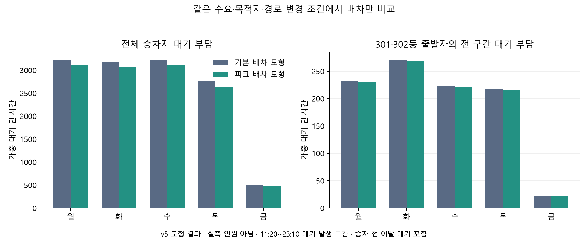

# 요일·시간·승차지별 병목과 버스 혼잡 근거 조사

분석일 2026-11-08. **할루시네이션 방지 O. 아래 인원·대기시간·혼잡률은 표시한 범위의 모형 계산이며 실제 현장 줄을 관측한 결과가 아닙니다.**

## 1. 결론과 범위

고정된 v5의 기본·피크 배차 10개 실행을 비교했습니다. 전체 대기 인·분은 피크 배차에서 3.61% 감소했지만 301·302동 출발자의 전 구간 대기는 0.87% 감소에 그쳤습니다. 월~목 행정관의 수업 종료 후 유입과 윗공대 제1공학관의 12:20 전후 유입을 따로 다뤄야 합니다. 특히 윗공대의 주요 병목 시간과 기존 15~19시 셔틀 배차 개선 시간은 다릅니다.

승차지 99개 노드(셔틀 44, 시내버스 55), 월~금, 30분 단위로 분석했습니다. 양 끝은 11:20~11:30·23:00~23:10으로 잘립니다. 기본·피크 합계 24,750개 노드 구간과 75,026개 차량 구간 집계를 보존했습니다. 한 정류장의 여러 셔틀 대기열은 같은 stop_id 안에서 합산했고, 합산 최대줄을 각 열의 최대값 합으로 계산하지 않았습니다. 다른 ID의 근접 정류장은 임의로 합치지 않았습니다.

## 2. 무엇을 세었는가

- **대기 인·분**: 실제 시계 구간에 존재한 가중 줄 길이를 시간에 적분한 값입니다. 줄을 떠나 도보·다른 노선으로 바꾸기 전까지의 대기도 포함합니다. 30분 동안 평균 100명이 기다리면 3,000인·분입니다.
- **평균줄·최대줄**: 각각 구간 내 시간평균과 동시 대기열 최대 가중치입니다. 도착 인원이나 차량 탑승 인원과 다릅니다.
- **평균/P90 대기**: 해당 30분에 줄에 도착하고 결국 그 줄에서 승차한 흐름의 대기입니다. 승차 완료자만의 수치라는 선택 편향이 있어, 이탈자를 포함한 평균 대기 노출도 별도로 제공합니다.
- **승차 거절 비율**: 해당 구간 도착 흐름 중 한 번 이상 정원 때문에 못 탄 가중치 비율입니다. 같은 사람의 여러 정류장 대기·반복 거절을 전교 고유 학생 수로 합산하지 않습니다.
- **차량 혼잡**: 모형의 학생 유래 차내 가중치/참고 정원입니다. 외부 승객이 빠져 있고 실제 노선별 차량 정원을 확인하지 못해 실제 버스 혼잡률과 같지 않습니다.

## 3. 요일별 정류장 전체 부담이 큰 시간

다음은 정류장 ID 내 여러 대기열을 합산한 시간평균입니다. 한 줄의 승차완료자 대기시간과 합산하지 않습니다.

| 요일 | 최대 부담 정류장·시간 | 평균 대기 가중치 | 대기 인·분 |
| --- | --- | --- | --- |
| 월 | 행정관 15:30~16:00 | 198.3 | 5,947.9 |
| 화 | 행정관 15:30~16:00 | 166.4 | 4,992.8 |
| 수 | 행정관 15:30~16:00 | 195.6 | 5,866.9 |
| 목 | 행정관 17:00~17:30 | 190.7 | 5,720.1 |
| 금 | 관악사삼거리 13:00~13:30 | 44.6 | 1,339.2 |

정류장별 상위 5개 시간대와 각 열의 상위 5개 시간대는 `bottleneck_summary.json`에 있습니다. 모든 30분·정류장 결과는 `queue_cells.csv`, 합산 정류장은 `physical_stop_cells.csv`에 있습니다. 정류장이 한 시간대에서 덜 혼잡해도 다른 시간·다른 방향의 병목이 사라졌다는 뜻은 아닙니다.

### 단일 승차열의 요일별 최대 부담

| 요일 | 승차열·시간 | 평균줄 / 최대줄 | 승차자 평균 / P90 분 | 도착 흐름 거절 비율 |
| --- | --- | --- | --- | --- |
| 월 | 행정관 · 행정관 셔틀 15:30~16:00 | 132.4 / 320.9 | 8.7 / 15.5 | 48.4% |
| 화 | 법대.사회대입구 · 시내버스 17:00~17:30 | 109.3 / 135.2 | 30.6 / 35.4 | 96.7% |
| 수 | 행정관 · 행정관 셔틀 15:30~16:00 | 131.8 / 300.2 | 10.3 / 14.4 | 73.7% |
| 목 | 행정관 · 행정관 셔틀 17:00~17:30 | 125.7 / 286.0 | 11.3 / 13.8 | 95.4% |
| 금 | 관악사삼거리 · 시내버스 13:00~13:30 | 44.6 / 83.8 | 17.8 / 24.0 | 60.1% |

화요일 법대·사회대입구 17시대처럼 승차완료자 평균이 30분을 넘는 사례도 있습니다. 이 수치를 실제 30분 대기 관측으로 주장할 수는 없으며, 해당 노선 선택·수요 가정과 실측 대조 우선순위를 정하는 용도로 사용합니다.

## 4. 윗공대에 집중하면

윗공대 출발자는 강의실이 301·302동인 종료 사건입니다. 학생 소속이 공대라는 뜻이 아니며, 이들이 나중에 행정관 등에서 기다린 시간까지 따로 합산했습니다.

| 요일 | 윗공대 승차지 최대 부담 시간 | 평균줄 / 최대줄 | 승차자 평균 / P90 분 | 도착 흐름 중 이탈 비율 |
| --- | --- | --- | --- | --- |
| 월 | 유회진학술정보관.제1공학관 12:00~12:30 | 47.4 / 207.3 | 10.1 / 23.1 | 43.0% |
| 화 | 유회진학술정보관.제1공학관 12:00~12:30 | 63.8 / 274.8 | 10.2 / 20.4 | 37.8% |
| 수 | 유회진학술정보관.제1공학관 12:00~12:30 | 47.4 / 209.9 | 9.3 / 19.9 | 41.5% |
| 목 | 유회진학술정보관.제1공학관 12:00~12:30 | 60.7 / 267.9 | 9.1 / 17.8 | 35.4% |
| 금 | 유회진학술정보관.제1공학관 17:30~18:00 | 5.3 / 47.3 | 2.3 / 4.5 | 27.4% |

개인별 마지막 수업 정보가 없어 12시대의 움직임이 실제 귀가라고 확인된 것은 아닙니다. 기존 피크 배차 정책의 시간창인 **15~19시로 제한**하면, 제1공학관에서 다음 구간의 대기 부담이 가장 큽니다. 그날의 가장 긴 개인 대기시간을 고른 표가 아니라 대기 인·분이 가장 큰 구간입니다.

| 요일 | 15~19시 윗공대 최대 부담 시간 | 평균줄 | 승차자 평균 / P90 분 |
| --- | --- | --- | --- |
| 월 | 15:00~15:30 | 34.3 | 5.9 / 19.3 |
| 화 | 15:00~15:30 | 37.0 | 5.3 / 13.8 |
| 수 | 15:00~15:30 | 33.4 | 5.2 / 14.4 |
| 목 | 15:00~15:30 | 36.6 | 4.9 / 8.4 |
| 금 | 17:30~18:00 | 5.3 | 2.3 / 4.5 |

월~목은 모두 유회진학술정보관·제1공학관의 12:00~12:30이 윗공대 승차지 최대 부담입니다. 화요일은 같은 구간에 도착한 가중 이동 493.7 중 186.5가 이 줄을 떠났습니다. 승차완료자 평균 10.2분만 제시하면 이탈을 숨기게 되므로, 전체 도착 흐름의 줄 대기 노출 평균 6.8분도 함께 기록했습니다. 이탈 뒤의 도보·다른 정류장 대기는 정류장 노출 평균에는 들어가지 않으며 전체 경로 지표로 봐야 합니다.

### 원인은 30분 총공급 부족만으로 설명되지 않습니다

화요일 제1공학관의 12:20~12:25 유입은 434.8가중 이동으로, 12:00~12:30 도착량의 약 88.1%입니다. 그 구간 전체에서 여러 노선이 제공한 잔여 공간은 합계 710.4였지만 실제 승차는 114.9에 그쳤습니다. 상당수 차량이 유입 전에 지나가고, 경로별로 탈 수 있는 노선·방향이 달랐기 때문입니다. 이 공간을 목적지와 시각을 무시한 하나의 공용 정원으로 사용할 수 없습니다. 해당 30분 차량 20회 중 2회는 상류 탑승으로 공간이 없었고, 5회는 해당 차량에 탈 수 있는 사람이 남았습니다.

월요일 행정관은 15:20~15:30에 약 492.5가 유입됐고, 15:30 출발 후에도 약 285.5가 남았습니다. 15:18 차량은 비어 떠났습니다. 목요일도 16:50~17:00에 약 405.0이 모였습니다. 따라서 수업 종료시각이 아닌 **실제 정류장 유입시각**에 예비 용량을 맞춰야 합니다. 이 결과는 수업 종료·건물 이탈·보행 가정이 만들어 낸 유입이며 현장 실측 유입은 아닙니다. 5분 유입·차량 공급 원장은 `pulse_diagnostics.json`입니다.

## 5. 이미 비교한 개선책: 피크 배차

기본 배차에서 15~19시 행정관 셔틀 4→3분, 순환 6→5분으로 바꾸고 목적지·출발 집단·정원·경로 변경 규칙을 고정했습니다. 시내버스 배차는 두 조건에서 같습니다. 아래 감소율은 11:20~23:10에 발생한 전체 대기 부담 기준이며, 줄 이탈 전 대기도 포함합니다.

| 요일 | 전체 대기 부담 감소 | 301·302 출발자 전 구간 감소 |
| --- | --- | --- |
| 월 | 3.11% | 0.85% |
| 화 | 3.07% | 1.16% |
| 수 | 3.60% | 0.61% |
| 목 | 4.94% | 0.83% |
| 금 | 3.08% | 0.45% |

이 비교는 기존 고정 모형 안의 배차 정책 효과입니다. 실제 운행 결과나 새 4.8km/h 보행 가정의 결과가 아닙니다. 초기 경로 선택은 예전 고정 선택을 보존하고 대기 중 경로 변경으로 조정하므로, 모든 사람이 새 배차를 미리 알고 처음부터 최적으로 골랐다는 모형도 아닙니다.

## 6. 추가 해결책의 우선순위와 검증 방법

| 우선순위·조치 | 왜 필요한가 | 효과 판정과 제약 |
| --- | --- | --- |
| 1. 윗공대 월~목 12:15~12:40·15:15~15:40 목적지별 예비 수송·직결편 검토 | 특히 화·목 12:20 유입 집중, 오후는15:00~15:30 부담. 기존 피크 셔틀 증차의 혜택이 작음 | 첫차가 유입 전에 빠지지 않게 맞추고 실제 여석·수요를 확인. 새 직결편은 도로·회차·기사·예산 가능성 확인 후 모형에서 전체 경로 재계산 |
| 2. 행정관 15:20~15:50 및 16:50~17:20 수요에 예비 용량 배치 | 3분 간격이어도 순간 유입이 용량보다 큼 | 60명×20회/시=1,200명/시의 이론 상한. 짧은 유입 폭증은 별도 용량 또는 다른 경로 분산 필요. 최소간격을 임의로 더 줄이지 않음 |
| 3. 실제 도착·여석·총시간을 이용한 경로 안내 | 줄을 떠나는 비중이 커 대기시간만 줄이면 성과가 과장됨 | 기다리던 시간+새 도보+다른 노선·환승+차내시간을 포함해 총시간·P90·미도착을 비교. 경사·계단·보행약자 제약 포함 |
| 4. 배차 간격 안정화와 상류 만차 감시 | 현장 버스 뭉침과 상류 만차는 동일 평균간격에서도 대기를 키움 | 현장 간격 분산·탑승/하차·잔여 공간으로 검증. v5는 규칙적 배차이므로 뭉침 제어 효과를 이번 수치로 주장할 수 없음 |
| 5. 실제 배차·차량 회전을 확인한 기준선 | 공식 간격은 계획이고 v5는 실제 차량 배정·회전을 검증하지 않음 | 역순환 공지의 특정 시각 증차와 첨부 시간표 3대·20분의 관계를 배차명세로 확인. 같은 시각에 별도 차량이 더 출발한다고 임의 해석하지 않음 |

위 1~4는 추가 연구·시험할 후보입니다. 이번에 새로운 직결 노선이나 추가 차량을 전체 모형으로 재실행하지 않았으므로 절감 분수를 제시하지 않습니다. 줄을 교실이나 인접 정류장으로 옮기는 대책은 그 대기와 보행시간까지 합쳐 평가해야 합니다. 유입 집중을 단순히 분산시켜 줄만 줄이고 하교 총시간을 늘리는 정책은 개선으로 판단하지 않습니다.

배차 안정화의 학술 근거는 Daganzo(2009)의 실시간 간격에 따른 제어 분석입니다. 이 연구는 배차 불규칙 완화의 근거이며, 이미 규칙적인 모형에서 부족한 수송 정원이 늘어난다는 근거가 아닙니다. [논문·저자 소속기관 소개](https://its.berkeley.edu/publications/headway-based-approach-eliminate-bus-bunching-systematic-analysis-and-comparisons).

### 공식 시간표와 현재 모형의 차이

[서울대 2026-2 운행 공지](https://cse.snu.ac.kr/ko/community/notice/25464)는 9~10월 행정관 하교 17~19시의 일시 증차와 학기 중 19~21시 연장, 역순환 302동 출발 13:10·13:50·14:10·14:50의 2→3대 증차를 구별합니다. 한편 첨부 공식 시간표는 역순환을 이미 09:50~17:10·20분·3대로 표시합니다. v5의 20분 출발 시계에도 위 네 시각이 포함됩니다. 따라서 이를 별도 동시 출발 네 편이 누락됐다는 뜻으로 단정할 수 없습니다. 실제 배차명세로 차량 수와 출발 횟수의 관계를 확인해야 합니다. regular는 공개 계획의 대표 간격을 구현한 시나리오이고 실제 운행의 완전한 복제가 아닙니다. peak는 15~19시 3/5분 조건을 선택한 정책 시나리오입니다. 공식 계획은 실제 출발·정류장 통과 기록이나 현 계약서가 아닙니다.

## 7. 버스 혼잡: 시뮬레이션과 실측을 결합하는 범위

### 7-1. 모형의 차량 혼잡

| 구간·요일·시간 | 차량 시간가중 평균 점유 | 승객이 경험한 평균 점유 | 95% 이상 점유 차량시간 비중 |
| --- | --- | --- | --- |
| 월 15:30 행정관→서울대입구 | 75.0% | 95.6% | 70.1% |
| 목 17:00 행정관→서울대입구 | 79.2% | 96.5% | 70.1% |

예를 들어 월요일 15:30 행정관은 차량 시간평균이 75.0%여도 승객이 경험한 평균은 95.6%입니다. 빈 차량이 평균을 낮추는 동안 많은 승객은 만차에 가까운 차량에 몰리기 때문입니다. 95%는 이 보고서가 정한 모형상 근만차 기준이며 서울시 혼잡 등급의 임계값이 아닙니다. 시내버스는 외부 승객을 포함하지 않아 위와 같은 값도 전체 차량 혼잡률로 쓸 수 없습니다.

### 7-2. 이번에 확인한 실제 혼잡 등급

이미 저장된 수집기 기록의 2026-11-07·08 두 날짜만 읽었습니다. 새 서울시 버스 API 호출이나 수집 작업은 시작하지 않았습니다. 전체 노선 위치 기록 10,610행을 제공시각 기준 중복 제거해 10,261행, 차량·추정 운행·구간당 최초 등급 기준 8,652건으로 정리했습니다. 이 숫자 전체가 캠퍼스 구간 관측은 아닙니다. 아래는 모형에 있는 동일 노선·구간 순번만 남긴 관측입니다. 운행 추정은 순번 역전 또는 30분 초과 공백으로 분리한 것으로 공식 운행 ID가 아닙니다.

| 날짜 | 노선 | 구간 통과 표본 | 등급 제공 표본 | 여유 / 보통 / 혼잡 / 매우혼잡 | 정보 없음 |
| --- | --- | --- | --- | --- | --- |
| 11-07 | 5511 | 485 | 469 | 468 / 1 / 0 / 0 | 16 |
| 11-07 | 5513 | 324 | 316 | 313 / 3 / 0 / 0 | 8 |
| 11-07 | 5515 | 1 | 1 | 1 / 0 / 0 / 0 | 0 |
| 11-07 | 5516 | 585 | 572 | 557 / 15 / 0 / 0 | 13 |
| 11-07 | 5528 | 1 | 1 | 1 / 0 / 0 / 0 | 0 |
| 11-07 | 6515 | 1 | 1 | 1 / 0 / 0 / 0 | 0 |
| 11-07 | 관악02-1 | 326 | 0 | 0 / 0 / 0 / 0 | 326 |
| 11-07 | 관악02-2 | 37 | 0 | 0 / 0 / 0 / 0 | 37 |
| 11-08 | 5511 | 726 | 707 | 543 / 150 / 14 / 0 | 19 |
| 11-08 | 5513 | 517 | 503 | 403 / 91 / 9 / 0 | 14 |
| 11-08 | 5515 | 111 | 111 | 52 / 59 / 0 / 0 | 0 |
| 11-08 | 5516 | 1013 | 990 | 972 / 16 / 2 / 0 | 23 |
| 11-08 | 5528 | 50 | 50 | 32 / 16 / 2 / 0 | 0 |
| 11-08 | 6515 | 68 | 68 | 33 / 35 / 0 / 0 | 0 |
| 11-08 | 관악02-1 | 778 | 0 | 0 / 0 / 0 / 0 | 778 |
| 11-08 | 관악02-2 | 133 | 0 | 0 / 0 / 0 / 0 | 133 |

11/7 원자료 제공시각 범위는 19:43:55~23:09:59, 11/8은 11:13:37~15:41:57입니다. 일부는 수집시각보다 오래된 제공시각이며, 연속 감시·모든 차량 포착을 보장하지 않습니다. 토·일요일의 부분 자료이므로 월~금 수업 종료 피크를 검증하는 표본이 아닙니다. 관악02 두 갈래는 현재 등급이 모두 0이며, 이를 여유로 처리하지 않습니다.

[공식 버스위치 API 명세](https://www.data.go.kr/data/15000332/openapi.do)는 congetion=0을 없음, 3~6을 여유·보통·혼잡·매우혼잡으로 설명합니다. 이 명세에는 이번 분석에서 사용할 수 있는 정원 대비 백분율 경계가 없습니다. 따라서 등급을 임의로 25/50/75/100%로 환산하지 않았습니다. 실측 등급과 모형 정원 점유는 별도 값으로 보존합니다.

### 7-3. 평일 20일의 과거 구간 승객수

[TAIMS 원자료 설명](https://t-data.seoul.go.kr/dataprovide/trafficdataviewopenapi.do?data_id=1025)의 2026-09-07~18, 10-19~30 평일 20일·8개 노선 저장본을 사용했습니다. 총 231,360개 시간·구간 셀 중 재차합 183,397개, 결측 47,963개입니다. 평균 재차인원·최대·운행횟수는 모두 비어 있었습니다. 반환 키의 다른 철자·대소문자도 다시 검사했습니다(`history_alias_check.json`). 결측을 0으로 대체하지 않았습니다.

노선·구간 ID·방향·요일·시간이 일치하는 모형-과거 맥락 비교 29,810행을 만들었습니다. 과거 각 요일의 네 날짜 평균과 단일 가정 수요를 비교하는 것으로, 같은 날짜의 예측 오차 검증은 아닙니다. 시간당 재차합을 계획상 운행횟수로 나눠 실제 한 대의 승객수로 만들거나, 30분 자료처럼 쪼개거나, 모형 학생 수에 더해 외부 승객을 만들지 않았습니다. 같은 승객을 중복 더하고 실제·계획 운행횟수를 혼동할 위험이 있기 때문입니다.

화요일 12시 제1공학관 출발 구간의 규모를 대조하면 다음과 같습니다. 5511은 동일 정류장을 두 번 방문하므로 구간 순번을 구별했습니다. 모든 과거 값은 같은 요일 네 날짜의 평균이고, 모형 값은 학생 유래 성분만의 재차합입니다.

| 노선·구간 순번 | 모형 학생 재차합 | 과거 전체 재차합 평균 | 과거 날짜 수 |
| --- | --- | --- | --- |
| 5511 / 66 | 51.7 | 29.8 | 4 |
| 5511 / 13 | 116.2 | 81.0 | 4 |
| 5513 / 2 | 104.6 | 26.0 | 4 |
| 5516 / 65 | 143.6 | 39.2 | 4 |
| 관악02-1 / 23 | 134.7 | 72.2 | 4 |

모형의 학생 성분만으로도 과거 전체 재차합보다 큰 구간이 있습니다. 특히 5513·5516은 약 4.0배·3.7배입니다. 날짜와 가정이 달라 모순이나 예측 오차로 단정할 수는 없지만, 절대 수요·줄 길이의 현실 보정이 필요하다는 신호입니다. 따라서 과거 전체에서 모형 학생 수를 뺀 값을 외부 승객으로 사용하지 않습니다. 수업 직후 이동 50%·개인별 마지막 수업·목적지 비중·노선 선택·평일 유입을 실측으로 보정한 뒤, 독립 날짜에서 검증해야 실제 증차 대수를 정할 수 있습니다.

### 7-4. 추정값과 검증값의 표시 원칙

현재 가능한 결합은 **동일 노선·구간의 모형 학생 점유 + 과거 평일 시간별 수요 맥락 + 시각이 명시된 실제 차량 등급**을 나란히 제시하는 것입니다. 현재 자료만으로 평일 30분별 실차 혼잡도 확률이나 관측 사이의 혼잡 등급 정확도를 새로 검증할 수는 없습니다. 현장/차량 관측이 있는 날짜·구간을 독립 검증용으로 확보한 뒤 보정해야 합니다.

혼합 추정기를 추가할 경우 최신 동일차량 관측의 경과시간·구간 이동, 실제 등급의 변화, 수업 유입과 잔여 공간을 입력으로 삼고, 날짜 단위로 학습/검증을 분리해야 합니다. 반복 조회를 독립 표본으로 세지 않고, 미제공·주말·배경 승객의 차이를 명시합니다. 관측이 만료되면 모형 추정이라는 표시와 자료 나이를 유지하며 실측값으로 보이지 않게 합니다. 지금 단계에서는 이러한 예측기를 새로 적합·검증했다고 주장하지 않습니다.

## 8. 현장 조사·실증 우선순위

우선 화·목 제1공학관 12:10~12:50, 월·수 행정관 15:15~16:00, 목 행정관 16:45~17:30을 같은 날짜의 수업·차량 기록과 맞춰 관측하는 것이 합리적입니다. 금요일은 관악사삼거리 12:45~13:45·16:45~17:45가 비교 대상입니다. 관측 우선순위는 모형 순위이며 실제 순위 확정이 아닙니다.

1. 1분마다 노선·방향별 줄 길이와 새 유입·줄 이탈을 기록합니다. 고유 개인을 추적하지 않아도 유량 보존을 확인할 수 있습니다.
2. 차량별 실제 도착·출발·탑승·하차·만차 잔류와 실제 차량 정원을 같은 시계로 기록합니다. 정원 합계보다 유입 이후 탈 수 있는 잔여 공간이 중요합니다.
3. 수업 종료→정류장 도착과 줄 이탈 후 최종 도착시간을 표본으로 관측합니다. 실제 마지막 수업 여부·경사·계단·비·공강·개인 목적지도 별도로 조사합니다.
4. 같은 요일·수업 조건에서 기준/시험 운행을 비교하고 전체 대기 인·분, P90 총시간, 승차 실패, 다른 승객의 지연, 운행시간·추가 비용을 함께 봅니다. 수강인원이나 줄이 줄었다는 이유만으로 효과를 확정하지 않습니다.

## 9. 중요한 가정과 남은 자료

- 수요 기반은 2026-11-06 보존 2026-2 강좌검색의 종료시각·강의실·수강신청인원입니다. 6,201 종료 사건, 인원합 156,338에 직후 이동 50%를 적용해 주간 78,169 가중 이동 사건을 만들었습니다. 실제 출석·오늘의 마지막 수업·개인별 연계 수강은 없어 같은 학생의 다른 종료 사건이 포함될 수 있습니다.
- 목적지의 서울대입구·낙성대·대학동 비중과 기숙사 5,772/29,613 비율은 이전에 채택한 참고 시나리오입니다. 현재 관악 수강생의 실제 방향별 비중·기숙사 거주율로 검증되지 않았습니다. 정류장 절대 인원을 실측값으로 주장할 수 없는 이유입니다.
- 대형 셔틀60·역순환25, 시내50·마을24는 현 모형 조건입니다. 시내50/24는 제조사 참고 사양을 이용한 시나리오이며 노선별 실제 차량의 법정·허용 정원을 확인한 결과가 아닙니다. [대형 참고](https://www.wjis.co.kr/kr/business/apollo1100.php), [중형 참고](https://www.wjis.co.kr/kr/business/apollo900.php).
- 교내 최고40km/h·교외 목표65km/h, 저장 구간속도와 가감속·정차 시계가 적용됩니다. 날짜·요일별 실제 완주시간 평균이 아니며 실제 차량 회전·기사 휴게를 만족하는 차량 배정도 아직 없습니다.
- 새 일반 보행4.8km/h 요청은 이 보고서의 고정 v5 결과에 반영되지 않았습니다. 보행을 바꾸면 도착·대기·승차 거절·경로 변경이 연쇄적으로 달라져 기존 줄을 단순 시간 이동시킨 결과를 새 전체 시뮬레이션으로 부를 수 없습니다.
- 실제 총학생회 결과 원표·개인 목적지 연결·정류장 유입·차량별 배치/운행일지·현행 계약서·기사·차량 운영 제약은 이번 자료로 새로 확보하지 못했습니다. 공식 공지를 계약 원문으로 대체하지 않습니다.

## 10. 산출물·검산·재현

`analyze_baseline.py`는 v5 원본의 대기와 차량 구간을 읽어 집계합니다. `read_saved_observations.py`는 기존 저장 자료만 내보내며 새 서울시 API·수집기를 실행하지 않습니다. `build_study.py`는 집계와 보고서를 생성합니다. 원본 모형·앱·배포 파일을 변경하지 않았습니다.

- `queue_cells.csv/json`: 모든 정류장 대기열의 30분 지표·공급·거절·이탈.
- `physical_stop_cells.csv/json`: 동일 정류장 ID의 시간대별 합산 부담.
- `modeled_occupancy_cells.csv/json`: 차량 구간별 모형 점유·승객 체감 점유·근만차 비중.
- `historical_context_comparison.csv/json`: 과거 요일·시간·구간 수요 맥락 대조.
- `bottleneck_summary.json`: 팀·구현 에이전트용 주요 수치와 해석 한계.
- `observed_grade_cells.json`, `observed_grade_summary.json`: 차량 식별자를 제거한 실제 등급 집계. 원시 기록과 비공개 passage 파일은 공유 사이트에 올리지 않습니다.
- `verification.json`: 10개 실행의 구간 적분과 원시 대기 노출 합 일치, 원본 입력 해시. 모든 대기 거절 가중치와 이벤트 합도 일치합니다.
- `study_verification.json`: 보고서 생성·등급 분모·비공개 자료 구분·입력 불변 확인.

이번 결과는 현장 조사와 개선안 설계를 구체화하는 근거입니다. 아직 확보하지 못한 평일 차량별·정류장별 실측을 모형 계산으로 채웠다고 표현하지 않습니다.
