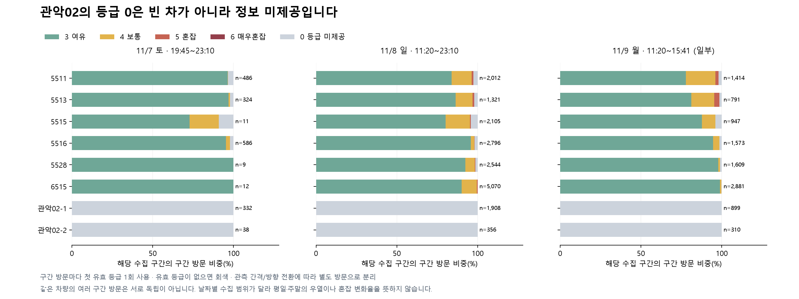

# 시내버스 혼잡 변화는 관측됐지만 저녁 대기모형의 계수를 바꿀 근거는 아직 부족합니다

할루시네이션 방지 O · 2026학년도 2학기 서울대학교 산업공학과 산업공학의 이해 7조

**판단:** 11월7일 토요일 늦은 저녁·8일 일요일·9일 월요일15:41까지의 보관 관측에서는 방향과 구간에 따라 등급 증가·감소가 모두 나타났습니다. 이를 실제 승객 증감 인원이나 대기시간으로 환산할 수는 없습니다. 평일18시 이후 관측과 실제 대기·탑승 결과가 없어, 원본 v5와 대기모델`261109152540`의 정원·배차·수요계수를 이 자료로 보정하는 것은 보류하는 편이 타당합니다. 현재 바로 적용할 수 있는 것은 결측·표본 범위·정류장 방향을 보존하는 품질 규칙입니다. 이 보고서는 검토 결과이며 모형이나 앱에 수정을 적용하지 않았습니다.

## 1. 원본을 확인하고 분석 단위를 줄인 이유

제공된[manifest.json](manifest.json)의8개 파일 해시를 대조했습니다. 원본 묶음700개에 차량 행45,861개가 있었지만, 같은 차량·노선·제공시각의 반복 조회3,142행을 제거하면42,719개 제공시각 관측입니다. 같은 제공시각에서 구간순번·등급이 충돌한 키는0개였습니다. 최초 포착 시점부터 제공시각이300초 넘게 지난5개 관측은 공간 변화 비교에서 제외했습니다.

남은42,714개 관측을 동일 차량·노선·날짜·원문 구간순번의 연속 방문으로 묶으면30,334개 **구간 방문**입니다. 관측 공백300초 초과·순번 감소·방향 전환은 별도 추적으로 끊었습니다. 방문마다 첫 유효등급을 대표값으로 쓰고, 유효등급이 없으면0(미제공)으로 유지했습니다. 이 숫자들은 독립 운행 수·고유 승객 수·정류장 줄 인원이 아닙니다.

| 날짜 | 저장 범위(KST) | 원본 차량 행 | 중복 제거 제공시각 관측 | 구간 방문 | 인접 유효 비교 |
| --- | --- | --- | --- | --- | --- |
| 2026-11-07 | 19:45~23:10 | 2,026 | 1,991 | 1,798 | 488 |
| 2026-11-08 | 11:20~23:10 | 22,416 | 21,709 | 18,112 | 9,070 |
| 2026-11-09 | 11:20~15:41 | 21,419 | 19,019 | 10,424 | 5,978 |

11/7의5515·5528·6515는 각각11·9·12행밖에 없어 노선 간 비교에 특히 부적합합니다. 저장된 조회간격은[saved_route_fetch_intervals.csv](saved_route_fetch_intervals.csv), 차량 제공시각 관측간격·지연은[일별 품질표](route_daily_quality_and_crowding.csv)에 있습니다. 기록 간격은 실제 배차간격이 아니며, 저장 오류가0이어도 수집 범위 밖 관측이 완전하다는 뜻은 아닙니다.

## 2. 등급과 결측에서 확인된 특징

일반6개 노선에서는 여유3·보통4·혼잡5가 관측됐고 매우혼잡6은 이 파일들에서 관측되지 않았습니다. 관악02-1·02-2는 모든 구간 방문의 혼잡등급이 미제공0입니다. 이를 빈 차·여석24명·혼잡도0%로 해석해서는 안 됩니다. **관측되지 않은 등급은 현실에 없었다는 증거가 아닙니다.**

`full_known=true`는 새 수집 형식이 적용된 **11/09 15:34:44~11/09 15:41:44**에만 있습니다. 원본1,287행/중복 제거1,183개 제공시각 관측에서 알려진 만차true는0개였습니다. 이전 형식에서11/8의`full=true`5행은 별도 참고 기록으로 남겼지만, 당시false들을 정상 여유 표본으로 분모에 넣지 않았습니다. 두 숫자 어느 쪽도 실제 탑승 실패율이 아닙니다.

월요일 일반6개 노선의 제공시각 기준 구간 방문 분포입니다. 같은 차량이 여러 정류장에 반복 포함되고15시는 일부이므로, 시간 간 우열이나 전체 서울대 승객의 혼잡률을 뜻하지 않습니다.

| 제공시각 기준 | 일반6개 노선 구간 방문 | 여유3 | 보통4 | 혼잡5 | 미제공0 |
| --- | --- | --- | --- | --- | --- |
| 11시 | 1405 | 1318 | 63 | 3 | 21 |
| 12시 | 1999 | 1809 | 123 | 31 | 36 |
| 13시 | 2017 | 1856 | 120 | 13 | 28 |
| 14시 | 1990 | 1895 | 64 | 1 | 30 |
| 15시 (15:41까지) | 1804 | 1603 | 187 | 6 | 8 |

## 3. 어느 정류장 구간에서 증가·감소했는가

**원문 순번A의 마지막 관측→바로 다음 순번B의 첫 관측**이 같은 차량·추적 방향이고 제공시각 간격300초 이내이며 양쪽 유효등급인 경우만 인접 비교로 계산했습니다. 정류장 대응은 노선ID+원문순번으로 했고, 같은 이름의 반대편·반복 정류장을 합치지 않았습니다. 별도 원문5515·5528·6515의226개 순번·정류장ID·이름이 대응표와 일치했습니다. 원문 구간순번 대응을 사용한 **관측 변화**이며, 정차·승하차 시점을 직접 확인한 실험이 아니므로 특정 정류장이 변화의 원인이라고 단정하지 않습니다.

| 날짜 | 인접 비교 | 등급 증가 | 감소 | 동일 | 여러 구간 건너뜀(별도) |
| --- | --- | --- | --- | --- | --- |
| 2026-11-07 | 488 | 4 | 4 | 480 | 754 |
| 2026-11-08 | 9070 | 228 | 206 | 8636 | 7218 |
| 2026-11-09 | 5978 | 65 | 68 | 5845 | 3211 |

월요일11:20~15:41의 대표 사례입니다. 서울대입구역3번출구로 들어오는 두 방향의 증가와, 교내 진입 후 감소가 모두 나타났습니다. 특히 서울대입구역3번출구→교내 방향 사례를 윗공대에서 역으로 내려오는 하교 방향의 증거로 바꾸어 읽으면 안 됩니다.

| 노선·방향 | 원문 순번과 대응 정류장 | 비교 n | 증가 / 감소 / 동일 | 서로 다른 차량 |
| --- | --- | --- | --- | --- |
| 5513 → 서울대학교 | 31 봉천사거리.위버폴리스 → 32 서울대입구역3번출구 | 21 | 6 / 1 / 14 | 11 |
| 5511 → 대학동고시촌입구 | 50 봉천사거리.위버폴리스 → 51 서울대입구역3번출구 | 24 | 5 / 1 / 18 | 15 |
| 5513 → 서울대학교 | 38 법대.사회대입구 → 39 자연대.행정관입구 | 12 | 0 / 6 / 6 | 9 |
| 5511 → 대학동고시촌입구 | 57 수의대입구.보건대학원앞 → 58 국제대학원 | 11 | 0 / 5 / 6 | 8 |
| 5515 → 청림동현대아파트 | 10 관악구청 → 11 서울대입구역2번출구 | 32 | 0 / 3 / 29 | 14 |
| 6515 → 양천공영차고지 | 73 관악구청 → 74 서울대입구역2번출구 | 21 | 0 / 3 / 18 | 21 |

전체 정류장·방향·날짜별 수치는[adjacent_changes_by_day.csv](adjacent_changes_by_day.csv), 시간별 수치는[adjacent_changes_by_hour.csv](adjacent_changes_by_hour.csv)에 있습니다. 관측이 여러 정류장을 건너뛴11,183쌍은[paired_section_observations.csv](paired_section_observations.csv)에`adjacent=False`로 별도 표시했으며 특정 한 정류장의 영향으로 배정하지 않았습니다. 같은 차량의 연속 쌍들이므로 독립 표본을 전제한 유의확률·신뢰구간을 붙이지 않았습니다.

## 4. 윗공대 하교 문제에 직접 사용할 수 있는 범위

월요일 윗공대 관련 순번의 구간 방문 대표등급입니다. 낮 시간 일부이며 정류장 실측 줄·탑승 여석이 아닙니다.

| 노선·방향 | 순번·정류장 | 구간 방문 n | 여유3 | 보통4 | 혼잡5·6 | 미제공0 |
| --- | --- | --- | --- | --- | --- | --- |
| 5511 → 대학동고시촌입구 | 65 제2공학관 | 21 | 21 | 0 | 0 | 0 |
| 5511 → 대학동고시촌입구 | 66 유회진학술정보관.제1공학관 | 16 | 16 | 0 | 0 | 0 |
| 5511 → 중앙대학교 | 12 제2공학관 | 17 | 17 | 0 | 0 | 0 |
| 5511 → 중앙대학교 | 13 유회진학술정보관.제1공학관 | 17 | 16 | 1 | 0 | 0 |
| 5513 → 벽산블루밍아파트 | 1 제2공학관 | 20 | 8 | 0 | 0 | 12 |
| 5513 → 벽산블루밍아파트 | 2 유회진학술정보관.제1공학관 | 17 | 17 | 0 | 0 | 0 |
| 5516 → 대학동고시촌입구 | 64 제2공학관 | 13 | 11 | 2 | 0 | 0 |
| 5516 → 대학동고시촌입구 | 65 유회진학술정보관.제1공학관 | 20 | 20 | 0 | 0 | 0 |
| 관악02-1 → 낙성대역 | 23 유회진학술정보관.제1공학관 | 23 | 0 | 0 | 0 | 23 |
| 관악02-1 → 서울대신공학관 | 22 제2공학관 | 43 | 0 | 0 | 0 | 43 |

5513 제2공학관(순번1)은20개 구간 방문 중12개가 등급 미제공입니다. 남은8개가 여유3이라는 사실만으로 이 출발지의 버스가 항상 비어 있다고 결론낼 수 없습니다. 관악02 역시 전부 결측입니다. **월요일18시 이후와 화~금이 없으므로, 현재 자료는 윗공대 저녁 병목의 원인·대기시간·추가 배차 필요량을 확인하지 못합니다.**

## 5. 높은 등급이 얼마나 이어졌고 어디서 낮아졌는가

동일 추적 안에서 혼잡5 이상이 연속 관측된 묶음49개를 찾았습니다. 그중46개는 뒤이어 낮은 등급 관측이 있었고3개는 공백·정보 미제공·추적 종료로 끝이 검열됐습니다. 첫 고등급부터 마지막 고등급까지의 관측 폭은 중앙값3.8분, 최댓값14.0분입니다. 한 번만 관측된 묶음의 폭0초도 포함되며, 실제 혼잡의 시작·끝이나 그 사이의 연속 상태를 확인한 지속시간은 아닙니다.

| 차량 추적 사례 | 혼잡5 이상이 관측된 범위 | 첫~마지막 고등급 관측 폭 | 다음 낮은 등급 관측 |
| --- | --- | --- | --- |
| 2026-11-09 5513 → 서울대학교 | 12:01:38 서울대입구역3번출구 → 12:09:55 법대.사회대입구 | 8.3분 (5관측) | 12:11:55 자연대.행정관입구 |
| 2026-11-09 5511 → 중앙대학교 | 12:39:44 서울대정문 → 12:47:44 서울대입구역2번출구 | 8.0분 (5관측) | 12:49:57 봉천사거리.봉천중앙시장 |
| 2026-11-08 6515 → 경인교육대학교 | 21:49:40 고척스카이돔.동양미래대.성심병원 → 22:03:40 영등포역 | 14.0분 (8관측) | 22:05:40 신길역5호선 |

개별 추적은 차량ID 대신 해시를 사용한[high_grade_spells.csv](high_grade_spells.csv)에 있습니다. 회복 정류장 사이에 건너뛴 순번이 있으면 전체 관측 구간으로 해석해야 합니다. 실제 회복 시각은 마지막 고등급 관측과 다음 낮은 등급 관측 사이에서만 제한됩니다.

## 6. 현재 모형과 무엇을 비교할 수 있는가

검토 대상은 대기모델`261109152540`/`frozen_v5_city_compatible_fifo_v1`입니다. `city_wait`는기준배차(`regular`)·5분 bin·50/150/250초3위상 조건부 FIFO 조회입니다. 146개 서비스·19,123개 프로필 행 중9,092행에 양의 **첫 호환 차량 대비 추가지연**이 있고845행에는 검열 위상이 있습니다. 이 행 수는 실제 지연 발생 횟수도 아니고 관측 표본도 아닙니다.

| 모형 요소 | 이번 관측으로 검토 가능한 점 | 아직 할 수 없는 일 |
| --- | --- | --- |
| 원본v5의 교외 배경 승객 미포함 | 교내 수업 수요와 별개인 시내 구간에서 등급 변화가 관측되므로 외부 수요를 따로 다룰 필요가 있다는 후보 근거 | 외부 승객 인원이나 차량 여석으로 환산해50/24에서 차감 |
| 보존v5 상류 재차·대기 흐름 고정 | 역→교내와 교내→역의 등급 전이가 다를 수 있어 방향·시각별 민감도 후보 | 기존모형 상류 가중인원을 실제 승객 수로 간주하거나 관측등급에 맞춰 임의계수 보정 |
| 조건부FIFO·원래 경로전환 이탈시각 유지 | 이번 파일에는 그 집단의 실제 대기 시작·탑승·경로전환 결과가 없음 | FIFO 대기시간MAE/WAPE·탑승실패 정확도 또는 행동계수 정확도를 계산 |
| 시내정원50/마을24·셔틀60/역순환25 | 현재 참조 시나리오라는 표시는 유지 | 혼잡등급0~6만으로 차종별 실제 등록정원·여석·추가차량 수를 역산 |
| 실시간 혼잡등급·만차 신호 | 등급0과`full_known`의 분모·기간을 분리해 표시/품질검사 | 만차플래그false만으로 줄 없음·반드시 탑승 가능이라고 표시 |

`city_wait.profiles`의 두 번째 열은 전체 대기시간이 아닙니다. 셔틀/시내 첫 도착예정과의 결합 계약을 유지해야 하며, 검열된 위상을 버리고 탑승한 위상만 평균내서는 안 됩니다. 별도 사용자 요청으로 발행한 시점 조회 UI는 원본 재생의 선택 시각 대기량과 같은30분 도착 구간의 탑승완료 평균을 구분해서 표시합니다. **이 관측 검토를 이유로 그 UI나 대기모델을 다시 발행하지 않았습니다.**

## 7. 수정 판단과 다음 확인 순서

| 판단 | 제안 | 근거·조건 |
| --- | --- | --- |
| 현재 적용 가능한 품질 규칙 | 등급0·알려지지 않은full은 결측으로 유지하고 노선/순번/방향·제공시각·수집범위를 함께 보존 | 실제 결측·짧은 스키마 기간이 확인됨. 이미 구현된 부분은 유지하고 누락 여부만 검토 |
| 현재 적용 가능한 품질 규칙 | 오래된 제공시각·긴 공백·다중순번 이동을 별도 표시하고 반복 조회를 새 표본으로 늘리지 않음 | 원본45,861행과 구간방문30,334개가 다르며 일부 제공값은 반복 재조회됨 |
| 독립 검증 뒤 가정 시나리오 후보 | 방향·시간별 외부 배경 수요/차량 여석의 낮음·높음 민감도 실험 | 역→교내 증감 사례는 존재하나 인원 환산계수는 없음. 기본값 보정과 분리하고 OD 재선택·공유차량 정원 검증 필요 |
| 추가 관측 후 검토 | 실제 정차 통과간격·만차 신호와 조건부FIFO 추가지연의 관계 확인 | 새 수집기 만차·근접 정차 통과 기록은 짧음. 여러 평일과18~23시 구간 확보 필요 |
| 현재 적용 보류 | 기본수요·정원·배차·경로전환계수/정류장별 대기 보정값 변경 | 평일 저녁·화~금·실제 대기 결과·독립 검증날짜가 없음 |

기존 승격 규칙인28일(14일 보정·7일 선택·7일 최종검증)을 유지하고, 주말/평일·방향·시간대를 구분합니다. 같은 날짜를 보정과 검증에 동시에 쓰지 않습니다. 정확한 대기시간 검증에는 대기 시작시각·실제 승차시각·타지 못한 회차·경로전환 여부가 필요합니다. 이 자료를 추가 수집하거나 연락을 보내는 작업은 이번 검토에서 실행하지 않았습니다.

## 8. 계산의 민감도와 검산

300초 공백 기준은 분석자가 택한 품질 기준이며 물리 상수가 아닙니다. 이미 구성한 동일 추적의 인접 쌍에서 더 짧은 간격만 남기면 다음과 같습니다. 새 계수를 학습한 실험이나 완전한 추적 재분할 민감도는 아닙니다.

| 허용 관측 간격 | 인접 유효 비교 | 증가 | 감소 | 동일 |
| --- | --- | --- | --- | --- |
| 120 | 11808 | 202 | 185 | 11421 |
| 180 | 15508 | 296 | 278 | 14934 |
| 300 | 15536 | 297 | 278 | 14961 |

원본 해시8개·원본행/중복제거 관측/구간 방문 합계·변화 분류 합계·순번 인접 조건을 검산했습니다. 대응 원문3개 노선226행을 직접 대조했습니다. 분석 스크립트는[analyze_observations.py](analyze_observations.py), 보고서/그림 생성은[build_review.py](build_review.py), 계산 요약은[analysis_summary.json](analysis_summary.json)입니다. 모든CSV는UTF-8 BOM이며 [stop_direction_hour_grades.csv](stop_direction_hour_grades.csv)에 정류장·방향·시간별 전체 등급 분포를 보존했습니다.

원본과 분석 결과는 **비공개 협업용**입니다. 공개 정적 사이트의 허용 목록에 넣지 않았습니다. 이 분석에서는 원본 모형·알고리즘·계수·배차·앱 코드·운영 배포를 수정하지 않았습니다. 별도 UI 작업의 발행과 구분합니다.
