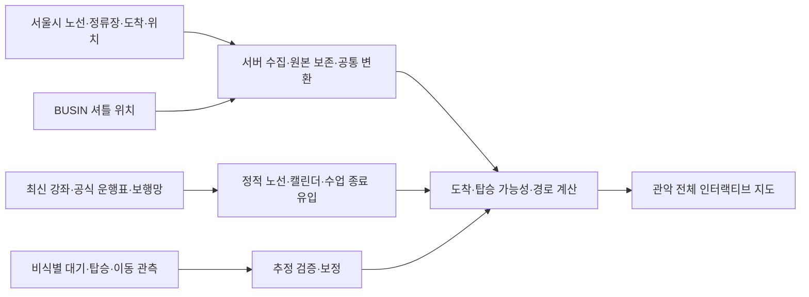

할루시네이션 방지 O

# 서울대 실시간 통합 이동 지도 — 기획안 v0.1

작성 기준: 2026-11-04 KST. 이번 산출물은 계획이며, 지도 구현·상시 수집·배포는 시작하지 않았다.

## 1. 목표와 확정 범위

**관악캠퍼스 어디에서든 기숙사·서울대입구역·낙성대역·대학동까지, 도보·시내/마을버스·학교 셔틀을 함께 비교하여 예상 도착이 가장 빠른 경로와 대안을 안내한다.** 수업 종료로 정류장에 사람이 몰릴 가능성을 예측하고, 그 영향이 실제 추가 대기로 검증되면 경로의 예상 소요시간에 반영한다.

- 사용자 확정: 첫 버전부터 **관악캠퍼스 전역 → 네 목적지**를 대상으로 설계·검증한다. 301·302동만으로 서비스 범위를 축소하지 않는다.
- 출발: 건물 검색, 지도 핀 지정, 사용자가 선택한 경우에만 현재 위치. 강의실 자체보다 출입구까지의 이동을 고려한다.
- 도착: 기숙사는 관악학생생활관의 동/출입구, 설입과 낙성대는 역 출입구, 대학동은 정류장 또는 사용자 지정 핀으로 구체화한다. 단일 대표점을 모든 이용자의 최종 도착지로 고정하지 않는다.
- 첫 교통수단 범위: 도보 + 관악캠퍼스를 경유하는 시내/마을버스 + 학교 셔틀. 필요한 캠퍼스 밖 연결 구간도 네 목적지까지 포함한다. 탐색 범위 밖 수단까지 포함한 절대적 최적 경로라고 표현하지 않는다.
- 이용 시각: 지금 출발과 지정 시각. 지정 시각의 미래 실시간 정보는 존재하지 않으므로 시간표/과거 관측 기반 예상으로 표시한다.
- 핵심 기준은 빠른 도착이다. 덜 붐비는 경로도 함께 보여주되, 혼잡하다는 이유만으로 더 빠른 경로를 숨기지 않는다.

## 2. 확인된 사실과 미확인 사항

| 데이터 | 확인 상태 | 이 계획에서의 역할 | 다음 확인 |
|---|---|---|---|
| 서울시 버스 위치·도착 API | 공식 문서에 위치·도착예정·혼잡도·만차 항목 존재. 이번 계획 작업에서는 서울시 인증키로 실제 대상 노선 응답을 받지 않았다. | 시내/마을버스 도착 예상 및 차량 혼잡 정보 | 서울대 경유 노선 목록, 마을버스 지원 범위, 노선별 결측과 갱신 지연, 인증키와 승인 한도 |
| 서울시 노선·정류소 API | 공식 서비스 존재 확인 | 정류장 좌표, 경유 순서, 노선 형상, 방향 식별 | 실제 대상 정류장·노선의 반환 항목과 정합성 |
| BUSIN 셔틀 API | 직전 대화에서 페이지 통신 및 별도 Python 요청 검증. 쿠키·Authorization 없이 HTTP 200, 심야 노선 차량 1건 반환. | 셔틀 운행 차량과 노선도상 위치 | 모든 현행 노선의 응답 범위·항목 의미·지연·이용 조건 |
| BUSIN 위치의 좌표 | 화면 코드에서 노선도상 x/y 및 이동 애니메이션에 사용됨 | 정류장 구간 추정의 입력 후보 | 위경도 제공 경로가 있는지. 없으면 노선도 좌표와 정류장 순서의 대응을 검증 |
| 기존 강좌 CSV | 오늘 재검사: 강좌 8,008행, 수업 슬롯 6,959행. 기준은 2026-07-03 공개 수강편람이며 수강신청인원 값은 전부 0. | 시간·강의실 파싱 구조를 재사용하는 예비 자료 | 최신 학기 강좌·시간·강의실·수강인원/정원 및 갱신 기준 |
| 캠퍼스 지도 | 공식 캠퍼스맵에 검색·길찾기·버스정류장 기능 존재 | 건물·정류장 위치 대조 | 재사용 가능한 좌표·보행망의 접근 조건, 경사·계단·통행 가능성 |
| 실제 정류장 대기열·탑승 실패 | 현재 확보하지 않음. 기존 관찰 CSV는 빈 양식. | 혼잡 예측과 추가 대기시간의 검증에 필수 | 비식별 현장 관찰 또는 운영기관의 익명 집계 |

**데이터를 받았다는 사실, 공식 공개 API로 제공된다는 사실, 재이용이 허용된다는 사실, 현재 추천 정확도가 검증됐다는 사실은 각각 별개다.**

### 확인된 셔틀 요청 예

```http
POST https://web.busin.co.kr/BuslineCircleS.aspx/GetRoute
Content-Type: application/json; charset=utf-8

{"data": ",F,41916,snu_1"}
```

- `41841`: 서울대입구역 ↔ 행정관 페이지.
- `41916`: 심야셔틀 페이지.
- 반환 JSON의 `d`는 차량 레코드를 `;`, 레코드 내부를 `/`로 구분하는 문자열이다. 빈 `d`를 가짜 차량 한 건으로 파싱하지 않는다.
- 화면 코드의 배열 위치는 차량 식별값 / 노선도 x / 노선도 y / 아이콘 배지에 사용되는 값 / 차량번호 문자열 / 코드 문자열이다. 확인되지 않은 코드나 배지 값을 승객 수·잔여 좌석으로 해석하지 않는다.
- 웹페이지는 5초 주기로 호출했지만, 이를 외부 수집 허용 주기나 호출 한도의 근거로 쓰지 않는다.
- 메뉴에 링크가 남아 있다는 이유만으로 현재 운행 노선으로 등록하지 않는다. 운행 0대 또는 빈 응답도 노선 폐지의 증거가 아니다.

## 3. 사용 흐름과 지도 화면

1. 출발 건물/핀과 도착 목적지·상세 지점을 고른다.
2. 지금 출발 또는 출발 예정 시각을 고른다.
3. 지도에서 시내버스·마을버스·셔틀·도보 구간을 구분해 표시한다. 실제 좌표가 없는 셔틀은 정류장 구간 및 위치 불확실성으로 안내한다.
4. 경로 카드에서 예상 도착시각, 소요시간 범위, 도보·대기·차내 시간, 환승, 요금 여부, 차량 혼잡 정보와 데이터 기준시각을 비교한다.
5. 가장 빠를 것으로 예상되는 경로와 다른 승차 정류장/노선을 이용하는 대안을 보여준다. 자료가 부족하면 우열을 단정하지 않는다.
6. 사용자가 경로를 선택하면 실제로 걸어갈 정류장 위치·승차 방향·탑승할 차량을 강조한다. 갱신으로 순위가 바뀌어도 선택한 경로를 조용히 바꾸지 않는다.

추천 이유의 예시는 “추가 보행이 있지만 예상 대기 감소가 더 큽니다”, “수업 종료에 따른 유입이 예상됩니다”, “셔틀 도착은 구간 위치에 기반한 추정입니다”처럼 근거와 행동을 연결한다. 근거가 없는 절약 시간이나 혼잡 확률을 숫자로 생성하지 않는다.

정류장 혼잡은 두 층으로 나눠 보여준다.

- **관측 정보:** 제공기관의 차량 혼잡도·만차 여부, 실제 관찰한 대기열.
- **예상 정보:** 강좌 종료·보행·시간대 패턴으로 추정한 정류장 유입 가능성. 관측과 같은 색상/표현으로 확정 사실처럼 보이지 않게 한다.

## 4. 통합 데이터 구조

제공기관별 원자료를 보존하고, 공통 구조로 변환한 결과를 따로 둔다. 항목별로 출처, 수집시각, 제공기관 기준시각(있을 때), 적용기간, 품질 상태를 기록한다.

| 공통 객체 | 핵심 필드 | 필요한 이유 |
|---|---|---|
| 정류장 | 기관별 ID, 공통 장소 ID, 위경도, 도로 방향, 승차 위치 | 같은 이름의 맞은편 정류장과 서로 다른 승강장을 혼동하지 않기 위해 |
| 노선/정차 순서 | 기관·노선 ID, 방향, 순번, 정류장 ID, 운행일·시간·예외 | 순환노선의 같은 정류장 재등장과 편도 운행을 표현하기 위해 |
| 차량 관측 | 기관·차량 ID, 노선, 현재 구간, 원 좌표 형식, 수집시각·제공시각, 품질 | 노선도 좌표·GPS·오래된 위치를 구분하기 위해 |
| 도착 예측 | 정류장·노선·차량, 예상 도착시각/범위, 생성시각, 근거 | 현재 위치와 도착 예상이 서로 다른 정보이기 때문에 |
| 강의 일정 | 학기, 강좌·분반·수업집단, 요일, 예정 시작/종료, 실제 강의실, 인원 지표의 종류, 기준일 | 개설 학과와 강의 장소, 정원과 수강인원을 분리하기 위해 |
| 보행 구간 | 출입구/정류장 간 연결, 거리, 방향, 경사·계단·횡단·시간 제약, 검증 상태 | 직선거리로 걷는 시간을 계산하지 않기 위해 |
| 혼잡 관찰 | 정류장·방향·목적지/노선 그룹, 시각, 유입·탑승·잔류·이탈, 관측 완전성 | 다른 줄을 합치거나 잔류자를 모두 탑승 실패로 세지 않기 위해 |

- 서울시 정류장과 셔틀 정류장은 이름·거리만으로 자동 합치지 않고 실제 승차 위치를 확인한다.
- 강좌 원본과 기존 조사자료를 수정하지 않는다. 신규 자료와 결과는 새 경로/버전으로 저장한다.
- 학번·개인 시간표·집 주소 없이 공개 강좌 및 비식별 집계부터 사용한다.

## 5. 경로 계산: 정류장까지 걸어가는 동안 버스도 움직인다

노드는 건물 출입구, 보행 분기점, 방향별 승차 정류장으로 만든다. 간선은 도보·승차·주행·환승·하차 후 보행을 나타내며, 출발 시각에 따라 이용 가능성과 소요시간이 변하는 방향 있는 그래프로 계산한다.

경로의 예상 총시간은 중복 없이 다음으로 분해한다.

`총시간 = 모든 도보시간 + 모든 정류장 대기시간(탑승 실패에 따른 추가 대기 포함) + 모든 차내시간 + 별도로 검증한 승하차 여유시간`

환승 때의 걷기와 대기는 이미 각 합계에 포함하므로 ‘환승 시간’을 다시 더하지 않는다.

계산 순서와 이유:

1. **출발지에서 후보 정류장까지의 도착시각을 계산한다.** 지금 가장 가까운 버스라도 이용자가 정류장에 도착하기 전에 떠나면 탈 수 없기 때문이다. 달려야만 가능한 연결을 기본 경로로 만들지 않는다.
2. **그 시각 이후 탑승 가능한 차량을 비교한다.** 현재 보이는 첫 차량뿐 아니라 다음 차량·다른 정류장·다른 노선·도보 전체 경로도 후보에 넣는다.
3. **차내 이동과 환승 연결을 계산한다.** 정류장 순서·방향·회차·환승 도보·막차를 확인한다. 첫 버스의 ETA를 목적지까지의 전체 소요시간으로 쓰지 않는다.
4. **검증된 혼잡 영향이 있으면 대기에 반영한다.** 혼잡도와 대기열, 앞 정류장에서의 승객 유입, 이용자의 승차 차례를 함께 고려한다. 차량 혼잡 등급만으로 정확한 잔여 좌석을 역산하지 않는다.
5. **최종 목적지까지의 도보를 더해 경로를 순위화한다.** 기숙사 권역 도착이나 역 근처 하차를 최종 출입구 도착과 같게 취급하지 않는다.
6. **예상 오차가 경로 간 차이보다 크면 두 대안을 함께 제시한다.** 수십 초의 불확실한 차이를 확실한 우열로 표시하지 않는다.

혼잡 반영 전후의 기대 대기는 ‘다음 차를 탈 수 있는 경우’와 ‘한 대 이상 놓치는 경우’를 나눠 추정한다. 탑승 실패 확률과 후속 배차가 관측되지 않은 상태에서 임의의 `혼잡 +5분` 같은 값을 부여하지 않는다. 편안함 선호 점수를 추가하면 실제 예상 도착시간과 별도 표시한다.

## 6. 수업 종료에서 정류장 유입까지

### 필요한 강좌 자료

- 최신 관악캠퍼스 강좌의 요일·예정 종료시각·실제 강의실과 건물·대면 여부·수강인원 또는 정원.
- 학사일정, 공휴일, 시험·휴강·보강 등 확인 가능한 예외. 공지되지 않은 휴강·수업 조기 종료를 실시간으로 안다고 주장하지 않는다.
- 전체 관악캠퍼스의 실제 강의 장소를 대상으로 한다. 이번 요청은 경로 서비스 범위가 캠퍼스 전역이므로 공대 개설 강좌만 필터링하지 않는다.
- 위치 미상·다른 캠퍼스·비대면·시간 미상은 분리한다. 공동강의·연속 강의/실습·실습반은 인원을 중복 복제하지 않도록 확인한다.

### 단계별 예측 논리

`수업 예정 종료 → 강의실/건물에서 나오는 시간 분포 → 정류장까지 보행시간 → 목적지·수단·정류장 선택 → 정류장 유입 → 차량 도착·수송 여유 → 추가 대기`

수업 종료와 정류장 도착 사이에는 시차가 있고, 수업을 마친 학생 전부가 하교하거나 같은 버스를 타는 것은 아니므로 이 순서를 생략하지 않는다.

모형을 설명하는 개념식은 다음과 같다.

`예상 유입(s,d,t) = 수업 외 기본 유입(s,d,t) + Σ[인원 근거(c) × 출석/이동 비율(c,t) × 목적지·수단·정류장 선택 비율(c,s,d,t) × 종료·보행 지연 분포(c,s,t)]`

- `s`: 방향별 정류장, `d`: 목적지/탑승 가능한 노선 그룹, `c`: 중복을 정리한 수업집단.
- 수강인원이 있어도 실제 출석 인원이나 버스 이용 인원이 아니다. 정원만 있으면 더 약한 대리지표로 취급한다.
- 수업 외 기본 유입에는 연구실·도서관·식사·방문객 등 수업표가 설명하지 못하는 이동이 들어간다.
- 출석률·목적지 비율·수단선택 비율은 현재 미측정이다. 임의의 고정 비율을 사실처럼 넣지 않는다.
- 학생들이 여러 후보 정류장/노선에 동시에 전부 배정되지 않도록 선택 비율의 합과 인원 보존을 확인한다.

### 관측이 부족한 첫 단계의 표현

1. 먼저 ‘어떤 건물에서 언제 수업이 많이 끝나는가’와 ‘그 영향이 어느 정류장에 언제 닿을 수 있는가’를 **유입 가능성 지표**로 만든다.
2. 최신 인원이 없으면 종료 수업 수·정원 대리지표를 구분하고, 실제 대기 인원·혼잡 확률로 바꿔 부르지 않는다.
3. 초기 지도에서는 유입 예상과 근거를 보여주고, 혼잡을 우회하는 경로도 비교 가능하게 한다. 분 단위 추가 대기 보정은 관측으로 검증되기 전까지 실측 기반 ETA에 섞지 않는다.
4. 실제 대기열·탑승/잔류·차량 간격을 모은 뒤 추가 대기와 탑승 실패를 추정한다. 그 예측이 기준모형보다 좋아졌을 때 ‘혼잡을 반영한 빠른 도착’ 순위에 통합한다.
5. 모델 검증은 미래 날짜를 떼어 평가한다. 같은 날 인접 관측을 무작위로 섞어 성능을 과대평가하지 않는다.

## 7. 셔틀을 실제 지도에 올리는 방법

**BUSIN의 x/y를 위경도로 넣거나 화면 비율로 캠퍼스 지도에 단순 투영하지 않는다.** 노선도가 지리적인 축척·각도·도로 형상을 보존한다는 근거가 없기 때문이다.

우선순위:

1. 제공기관이 이용 가능한 지리 좌표/도착 정보를 별도로 제공하는지 확인한다.
2. 없으면 노선별 정류장 이름·순서·운행 방향을 실제 정류장 좌표와 대응시킨다.
3. 노선도 x/y의 진행 위치를 정류장 구간으로 매핑하고, 현장에서 구간 판정의 정확도를 검증한다. 반복 정류장·회차·대기·회송은 따로 처리한다.
4. 지도에는 해당 구간 또는 정류장 단위의 위치와 불확실성을 표시한다. 도로 위의 정확한 차량 점이라고 표현하지 않는다.
5. 구간별 통행시간의 실제 관측을 쌓아 다음 정류장 ETA를 추정한다. 공식 도착예정시각과 자체 추정치를 구분한다.
6. 위치가 멈추거나 누락되면 ‘운행 없음’으로 단정하지 않고, 최근 관측 시각과 시간표 기반 대안을 보여준다.

## 8. 시스템 구성과 호출 예산



- 브라우저가 제공기관마다 직접 반복 호출하는 구조보다 서버에서 공동 수집하고 사용자에게 캐시를 공유한다. 인증키 관리, 호출량 제어, 서로 다른 응답시각을 정리하기 위해서다.
- 정류장·노선 형상·시간표·강좌는 변경 주기에 맞춰 갱신한다. 실시간 위치와 같은 주기로 가져오지 않는다.
- 실시간 조회는 승인 한도·운행시간·변화량에 맞춰 조정하고 오류 시 재시도 간격을 늘린다. 관련 항목을 한 번에 받는 조회를 우선 검토한다.
- 서울시 포털의 현재 기본 안내는 개발계정 트래픽 `1,000`이다. 집계 기간·서비스별 적용·증액 조건은 신청 화면과 운영정책에서 확인해야 한다. 현재 문서만 보고 ‘무제한 무료’ 또는 확인되지 않은 ‘하루 1,000회’로 단정하지 않는다.
- 호출량의 예시 계산: 노선 N개를 Δ초마다 한 번 조회하면 시간당 `3,600 × N / Δ`건이다. **가정상 N=10, Δ=5초면 시간당 7,200건**이며, 실제 대상 노선 수나 허용량을 의미하지 않는다. 제공기관별로 별도 계산한다.
- 정기 수집/배포는 후속 구현 작업에서 범위·주기·보존 기간을 정한 뒤 시작한다. 이번 계획 작업에서는 시작하지 않았다.

## 9. 수행 순서와 완료 조건

| 단계 | 수행 작업 | 왜 먼저 필요한가 | 완료 조건 |
|---|---|---|---|
| 1. 관악 전체 데이터 목록 확정 | 경유 시내·마을버스/현행 셔틀, 정류장, 출입구, 네 목적지, 운행 캘린더, 최신 강좌 목록 확보 | 지도와 추천의 범위 누락을 먼저 드러내기 위해 | 노선·정류장·건물·목적지 대응표와 미확인 목록, 자료별 기준일/한도/이용조건 정리 |
| 2. 전체 캠퍼스 기본 경로 | 보행망+방향별 노선+실시간 도착 통합. 도보 단독, 시내버스, 셔틀, 혼합 환승 비교 | 혼잡모형과 별개로 연결 가능한 경로가 정확해야 하기 때문 | 관악의 검증된 출입구 전부에 대해 네 목적지로 탐색. 단절·미지원 지점은 명시. 잘못된 방향/운행시간 추천 자동 검사 |
| 3. 수업 종료 유입 지도 | 최신 강좌의 건물/종료시각을 정류장 도착 가능 시간에 연결 | 수업이 혼잡을 설명하는지 검증할 특징을 만들기 위해 | 인원 지표·누락·중복 규칙과 시간 지연을 표시한 전역 유입 예상. 실제 혼잡으로 표기하지 않음 |
| 4. 전역 검증과 혼잡 보정 | 권역별·목적지별·시간대별 관찰, 보행/ETA 오차 및 탑승 실패 확인, 혼잡 없는 기준모형과 비교 | 빠른 경로와 우회 권고가 실제 이동을 개선하는지 확인하기 위해 | 비교 가능한 데이터에서 추가 대기 추정의 개선 여부 평가. 검증된 범위에 한해 ETA에 통합 |
| 5. 전역 시연 완성 | 장애·야간·막차·시험기간·데이터 지연 처리와 경로 비교 설명 | 평상시 한 사례만 작동하는 시연을 피하기 위해 | 네 목적지, 전 권역, 관측/추정/누락 표시, 오류 시 안내 및 출처가 포함된 검토 가능한 시연 |

이 단계들은 기능의 순서다. 첫 서비스의 지리 범위는 1~5단계 모두 관악 전역이다. 현장 검증은 모든 좌표를 동시에 실측할 수 없으므로 **권역 × 네 목적지 × 시간대**의 층화 표본으로 진행하고, 표본 수와 미검증 지점을 공개한다. 일정·인원·예산을 확인하기 전에는 완료 일자를 확정하지 않는다.

## 10. 검증 설계와 성공 판단

### 구조·데이터 정합성

- 방향별 정류장 구분, 순환 정류장 재등장, 편도·회송·막차·환승 도보를 테스트한다.
- 실제 추천 시각에 이용 가능한 노선인지 확인한다. 과거 한시 직행·여름 연장·9~10월 증차를 11월 기본 운행으로 연장하지 않는다. 최신 후속 공지가 있으면 적용기간을 갱신한다.
- 차량 혼잡도 ‘정보 없음’, 빈 응답, 수업 인원 결측, API 지연을 0명/여유/운행 중단으로 바꾸지 않는다.
- 제공시각과 수집시각을 구분하고, 수집 성공만으로 원자료가 최신이라고 판단하지 않는다.
- 최신 강좌와 7월 자료를 덮어 섞지 않는다. 강의실 미상과 강좌 중복 처리의 영향도 표시한다.

### 예측·추천 성능

| 비교 대상 | 측정할 것 |
|---|---|
| 시간표·단순 거리 기반 경로 | 실시간 정보가 없는 기준선 |
| 실시간 교통만 사용하는 경로 | 실시간 통합 자체의 개선 |
| 실시간 교통+시간대/정류장 과거 패턴 | 수업 데이터 없이도 설명되는 혼잡의 기준선 |
| 위 모델+수업 종료 유입 | 수업 데이터가 추가로 주는 개선. 효과가 없으면 강제로 ETA에 반영하지 않음 |

- 지표: 정류장 도착예측 절대오차, 최종 도착시간 오차/범위 포함률, 탑승 실패 예측의 적중·누락과 확률 보정(확률을 제공할 때), 실제 도보 부담, 데이터 유효율·전역 경로 연결률.
- 이동시간 절약은 같은 조건의 비교 가능한 관측·재생 또는 검증된 모형으로 평가한다. 사용자가 탄 한 경로의 시간만으로 타지 않은 경로보다 몇 분 빨랐다고 확정하지 않는다.
- 지도 클릭 수나 그럴듯한 시연을 실제 이동시간 개선의 증거로 사용하지 않는다.
- 수치 목표는 기초 오차와 관측 가능량을 먼저 확인해 합의한다. 현재 임의의 정확도·절약률을 성과로 약속하지 않는다.

## 11. 구현 전 확정할 항목

1. 네 목적지의 대표 선택지와 상세 도착 지점. 기숙사·대학동은 권역과 최종 지점을 구분한다.
2. 서울시 API 인증/승인량과 BUSIN 재이용·호출 조건. 인증키를 대화나 프런트엔드 코드에 넣지 않는다.
3. 최신 강좌 내보내기 경로, 강의실·요일·종료시각 및 인원 필드의 정의·누락률.
4. 캠퍼스 건물 출입구·보행망·정류장·노선 형상의 확보 방법과 이용 조건.
5. 전역 검증을 위한 비식별 관찰 인원·시간 및 과거 자료 제공 가능성.
6. 지도 라이브러리·배경지도·서버·저장소는 위 자료의 라이선스, 전체 범위, 비용·호출량을 확인한 뒤 선택한다.

선택적 선호로 ‘걷기 적게/환승 적게/무료 수단 우선’을 추가할 수 있으나, 기본 목적함수인 빠른 도착과 구분한다. 첫 설계의 핵심 의사결정은 끝없는 옵션보다 정확한 데이터 연결과 검증 가능한 추천이다.

## 12. 근거와 재검사 기록

외부 공식/제공기관 자료:

- 서울시 버스위치정보: https://www.data.go.kr/data/15000332/openapi.do
- 서울시 버스도착정보: https://www.data.go.kr/data/15000314/openapi.do
- 서울시 노선정보: https://www.data.go.kr/data/15000193/openapi.do
- 서울시 정류소정보: https://www.data.go.kr/data/15000303/openapi.do
- 서울대 캠퍼스맵: https://map.snu.ac.kr/web/main.action
- 서울대 최신 강좌 조회: https://sugang.snu.ac.kr/
- 동영관광 셔틀 선택 화면: https://sites.google.com/dongyeongtour.co.kr/snu/route
- BUSIN 행정관 노선 화면: https://web.busin.co.kr/BuslineCircleS.aspx?cd=snu_1&di=41841&tab=F
- BUSIN 심야 노선 화면: https://web.busin.co.kr/BuslineCircleS.aspx?cd=snu_1&di=41916&tab=F

현재 작업 폴더의 근거:

- `input_handoff/provenance_and_coverage.json`: 7월 공개 수강편람의 기준일과 한계.
- `input_handoff/sections_raw.csv`, `input_handoff/meeting_slots_raw.csv`: 이번 턴에서 행 수와 수강신청인원 값 재확인.
- `operation_plans_2026-11-01/세부배치시간_조사결과.md`: 11월 1일에 검증한 공식 운행표·한시 운행 종료·시험기간 변경의 구분. 이번 계획에서는 문서를 읽었으며 모든 원문을 새로 내려받지는 않았다. 실제 구현 전 최신 후속 공지를 다시 확인한다.
- `research/observation_templates/작성_안내.md`: 비식별 관측 및 인원 보존 원칙. 양식은 실제 관측값이 아니다.

정합성 확인: 사용자 확정 범위는 관악 전역이며, 셔틀의 노선도 좌표를 GPS로 취급하지 않았다. 수업 종료·정원·수강인원을 실제 하교/승차 인원과 구분했다. 혼잡 영향은 관측으로 보정하기 전까지 분 단위 ETA로 확정하지 않았다. 아직 지도 구현·예측 성능 평가·상시 수집·배포 결과는 없다.
