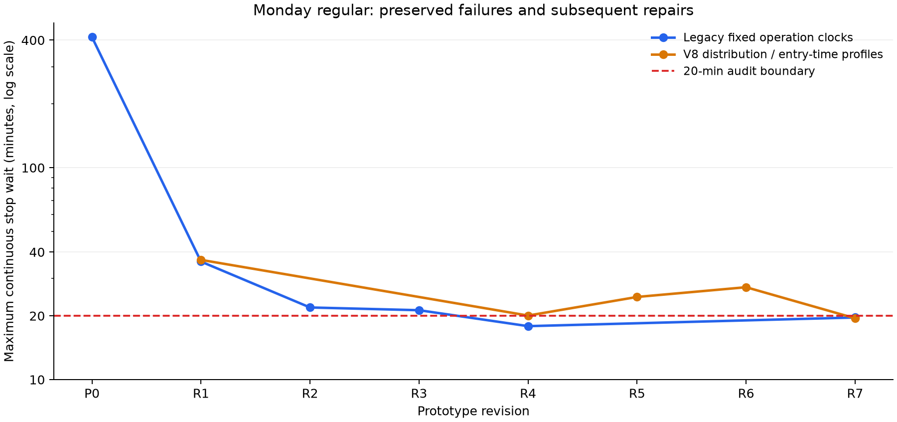
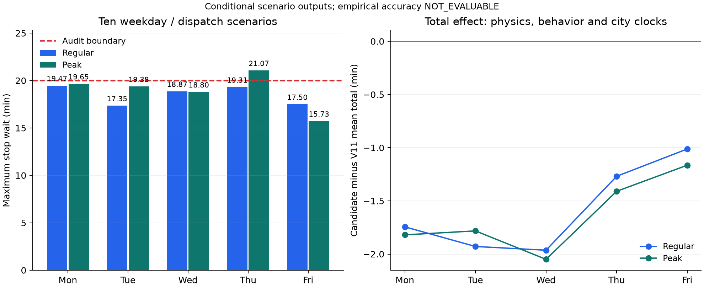

# 20분 초과 대기 원인과 후속 프로토타입 검증

작성: 2026-11-10T19:00:00+09:00. **운영 V11 유지, 프로토타입 미승격, 실측 정확도 NOT_EVALUABLE.**

## 판정과 적용 범위

내부 검증은 **NEEDS_FURTHER_REPAIR**, 최대 연속 대기는 21.07310분, 20분 초과 가중 대기 사건량은 0.054801, 미완료 통행량은 0.000000이다. 월~금×regular/peak10조건과 월요일regular추가seed1/2 총12조건을 계산·전수 검산했다. 부모 월요일regular1조건은 동일 코드·입력·감사 해시 확인 후 재사용했고11조건을 새로 실행했다.

주 기준은 지도 분석창11:20~23:10에 겹치는 모든 정류장 연속 대기이다. 동일 물리적 줄에서 호환노선을 추가하거나 판단을 다시 해도 시계를 초기화하지 않았다. 승차자뿐 아니라 걷거나 다른 정류장으로 떠난 방문도 포함했다. 창 밖 초기화 궤적의 최대·초과량은 별도 진단에 보존한다.

이는 유한 시나리오의 내부 품질 검사이다. 모든 난수와 현실의 모든 날에20분 이하라는 보장이 아니다. 합성 가중 통행·대기 방문·승차·재차·표시 점·고유 학생은 서로 다르다. 여러 시나리오의 가중 사건량을 더해 실제 학생 수로 부르면 안 된다.

사용자 후속 지시가 초기 개발요청서의 조건부 자동교체 규칙보다 우선한다. 내부 검사 통과 여부와 관계없이 새 명시 승인 전 운영 V11·latest·사이트 기본 모형·경로 앱 입력을 교체하지 않는다. 기존 자료와 실패 후보를 삭제하지 않았다.

## 횟수와 도보 행동

변경 횟수의 최댓값·예산·소진은 없다. 기본 재검토 성향은0.3^현재 변경횟수로 급감하며, 경과 대기와 개인 만차 경험의 스트레스는 별도 항으로 더해진다.100회 변경 후에도 스트레스에 따른 재검토 가능성이 남는 경계 검산을 포함한다. 평균1회는 강제 할당이나 횟수 상한이 아니다. 실제 평균과0/1/2/3/4/5+분포는 각 조건의 검산 JSON에 남겼다.

0~500m는 기본 도보 **상대 고려도**가 같고1km 이후 급감한다. 실제 선택 확률은 도보 소요시간·계단·대안·줄에 따라 달라지므로500m 안의 모든 보행 선택확률이 정확히 같다는 뜻은 아니다. 같은 노선의 뒤 정류장과 재방문에는 각각 낮은 별도 고려도0.08/0.05를 유지한다.

## 무엇이 장기 대기를 만들었나

첫 결합 후보의 최장413.27분 사례는 변경2회 이후 만차41회를 경험했다. 미래 차량이 아직 출발하지 않은0명 차내 상태를 하류 여석으로 낙관하고, 같은 줄의 유효 환승전략을 누락했으며, 반복 횟수 감소가 스트레스까지 억눌렀다. 최초7.53분 승차 예측과 모형에서 실현된317.53분 추가 대기를 감사자료로 재구성했다.

R1은 동일 정류장의 호환 환승전략·과거 여석 학습·별도 스트레스 위험률을 보완했다. R2는 여석 예측의 무한 지속을 제한하고, R3은 긴 예상 대기의 볼록 선호비용을 실제 ETA와 분리했다. R4는 승차를 자발적으로 거절하거나 만차로 남으면 즉시 대안을 재검토하게 했다. 재검토는 같은 시각 두 차량의 승차 처리가 끝난 뒤 실행한다.

R4의 V8 조건에는 도착3.465초 뒤 차량을 준비20초 때문에 놓쳐20분3.465초 기다린 사례가 남았다. R5의 광범위 도착 검토와 R6의 별도 변경 채택 규칙은 다른 장기 대기를 늘렸다. 두 결과를 그대로 보존하고, 최종 후보에서는 R4에서 준비 중 실제 호환차량을 놓친 경우 준비 완료 직후 재검토하는 누락만 보완했다. 20분에 강제로 떠나게 하거나, 준비시간·수요·줄·대기값을 자르거나, 공급을 늘리지 않았다.

## 수정별 비교 — 월요일regular

같은 운행시계 열끼리 비교해야 한다. baseline과 V8분포는 다른 공급시계 시나리오다. 개선은 비단조적이다. 초과량은 명 상당·회인 가중 대기 사건량이다.

|후보|운행시계|최대 연속 대기(분)|20분 초과량|총시간 평균(분)|변경 평균|
|---|---|---:|---:|---:|---:|
|P0|baseline|413.271|3820.1440|32.592|0.619|
|R1|baseline|36.053|449.1207|27.048|0.699|
|R1|distribution_v8|36.735|419.6233|27.337|0.731|
|R1|gate_reference|41.442|433.0228|27.275|0.712|
|R2|baseline|21.898|13.7888|27.964|0.824|
|R3|baseline|21.257|0.2101|25.878|0.764|
|R4|baseline|17.876|0.0000|25.795|1.056|
|R4|distribution_v8|20.058|0.4841|25.544|1.024|
|R4|gate_reference|20.058|0.4841|25.584|1.020|
|R5|distribution_v8|24.551|0.5389|25.734|1.257|
|R6|distribution_v8|27.290|0.8155|25.881|1.072|
|R7|distribution_v8|19.470|0.0000|25.755|1.082|
|R7|baseline|19.639|0.0000|25.706|1.074|
|R7|gate_reference|19.875|0.0000|25.810|1.084|

[반복 수정 CSV](iteration_comparison.csv) · [이전9파일럿 상세](../prototype_model_2026-11-10/RESULTS.md) · [장기 대기 실패 장부](long_wait_episodes.csv). 장부의 수록 범위와 후속 결과는 별도 메타데이터를 확인한다.

## 행동과 운행시간의 요인 비교

두 행동 알고리즘의 보행 물리시간4.8km/h·수요·출발·목적지·차량별44명/피크2대 입력을 맞춘 월요일regular 비교다. 이전 행동의 물리시간 분리 대조는 R1의 검증 완료 결과를 재사용했다. 같은seed0이 다른 알고리즘의 모든 난수 호출까지 같은 것을 의미하지 않는다.

|행동|운행시계|누적 대기 평균|도보 평균|총시간 평균|최대 연속 대기|20분 초과량|
|---|---|---:|---:|---:|---:|---:|
|previous_behavior|baseline|8.456|10.810|26.183|16.762|0.0000|
|previous_behavior|distribution_v8|8.949|10.925|26.758|17.200|0.0000|
|previous_behavior|gate_reference|8.955|10.870|26.707|17.207|0.0000|
|candidate_behavior|distribution_v8|6.083|11.578|25.755|19.470|0.0000|
|candidate_behavior|baseline|5.995|11.428|25.706|19.639|0.0000|
|candidate_behavior|gate_reference|6.215|11.407|25.810|19.875|0.0000|

V8는 과거 관측에서 유도한 배차 분포와 구간 **진입시각**에 따른 구간시간을 쓴다. 정문 도킹 절대시계 참조는 별도gate_reference진단이며 출발·승차의 실측 정답이나 같은V8분포로 표시하지 않았다. 시내버스의 보정만 적용하고 셔틀 시각은 보존했으며 관측 구간시간에 정차를 다시 더하지 않았다. 월요일 자료를 다른 요일로 전이한 것은 가정이다.

## 평일 전체와 추가 난수

아래 V11대비 총시간은 보행 물리시간과 행동·시내버스 운행시계가 함께 달라진 전체 효과다. 순수 행동 효과는 앞의 같은4.8km/h요인표로 확인한다. 각 평균은 분석창 밖 출발도 포함하는 전체 입력 부모 통행을 양쪽에 동일하게 사용한다. 대기 최대의11:20~23:10겹침 기준과 평균의 분모가 다르다. 미완료가 있는 경우 완료 조건부 분위수와 분리한다.

|요일|공급|V11→후보 총시간 평균(분)|후보 누적대기|후보 도보|V11→후보 최대 연속 대기|20분 초과량|미완료|
|---|---|---:|---:|---:|---:|---:|---:|
|월|regular|27.50→25.76|6.08|11.58|16.5944→19.4697|0.0000|0.0000|
|화|regular|27.39→25.46|6.02|11.17|17.2640→17.3530|0.0000|0.0000|
|수|regular|27.83→25.87|6.14|11.48|16.9177→18.8730|0.0000|0.0000|
|목|regular|26.75→25.48|6.08|10.96|16.5609→19.3104|0.0000|0.0000|
|금|regular|20.10→19.09|3.78|7.33|15.9691→17.4959|0.0000|0.0000|
|월|peak|27.25→25.43|5.97|11.36|16.5944→19.6542|0.0000|0.0000|
|화|peak|27.08→25.30|5.97|11.05|18.1420→19.3773|0.0000|0.0000|
|수|peak|27.53→25.48|5.95|11.38|17.5170→18.8006|0.0000|0.0000|
|목|peak|26.46→25.05|5.85|10.85|16.5609→21.0731|0.0548|0.0000|
|금|peak|20.05→18.88|3.70|7.27|15.9691→15.7301|0.0000|0.0000|

전 정류장 990행과 도착시각 기준30분 집계 12085행을 만들었다. 대기 방문이 없는 셀을 관측0명으로 해석하지 않는다.30분 표의 대기는 그 구간에 줄에 도착한 방문의 최종 연속 대기이며 해당시각 순간 줄 길이와 다르다.

[요일 비교 CSV](weekday_comparison.csv) · [전 정류장 CSV](../prototype_validation_261110182218/all_stops_waits.csv) · [30분 CSV](../prototype_validation_261110182218/half_hour_waits.csv) · [전체12조건·개인차·분위수 JSON](../prototype_validation_261110182218/validation.json).

## 도보·누적 대기·총시간의 꼬리 비교

20분은 한 정류장의 연속 대기 기준이다. 여러 정류장에서의 누적 대기나 전체 하교 시간이20분 이하라는 뜻은 아니다. 아래는 같은 원래 부모 통행 가중치 전체를 대상으로 계산한 상위1%경계와 최댓값이다. 중도 보행 전환자를 포함하며 전 조건의 미완료 통행량은 별도로 확인했다. 공급·보행 물리시간·행동이 함께 달라진 V11대비 전체 효과다.

|요일·공급|누적 대기 p99 V11→후보|도보 p99 V11→후보|총시간 p99 V11→후보|총시간 최대 V11→후보|
|---|---:|---:|---:|---:|
|월 regular|47.11→25.19|38.18→42.19|84.78→71.54|129.82→120.39|
|화 regular|46.58→25.20|38.29→42.68|83.54→68.75|136.63→136.08|
|수 regular|47.83→27.65|38.85→44.67|86.75→72.63|134.25→155.08|
|목 regular|44.10→24.68|37.02→39.68|81.14→70.18|101.33→122.02|
|금 regular|19.27→14.34|22.00→19.57|44.10→45.24|55.53→68.03|
|월 peak|47.14→25.83|38.25→40.76|85.34→68.98|129.82→130.62|
|화 peak|46.73→25.04|38.12→41.85|83.81→72.46|136.63→127.82|
|수 peak|48.01→25.88|38.97→43.25|87.04→70.36|134.25→163.29|
|목 peak|44.13→24.54|36.97→43.21|81.18→69.05|101.33→110.15|
|금 peak|19.27→13.99|22.00→19.10|43.98→45.14|55.53→68.03|

[모든 분위수·변경 횟수 40행 CSV](journey_tail_comparison.csv) · [양쪽 감사 해시·검산 JSON](journey_tail_comparison.json). 후보에 드문 장거리 보행·반복 전환·긴 총시간이 남을 수 있다. 연속 대기만 통과했다고 자연스러운 하교 행동이나 운영 준비 완료로 판정하지 않는다. 경로 유사성·인지 공급시계·승하차 체류를 검증할 때 이 꼬리도 함께 점검해야 한다.

## 줄 길이에 관한 별도 우려

서울대정문·법대/사회대입구 등에 대한 사용자 기억인 약40명은 실측 상한이 아닌 참고 기준이다. 최종10조건의 해당 정류장·방향별60셀 중8셀이40명 상당을 넘는다.20분 대기 기준의 통과만으로 이 정합성 우려가 해소되었다고 할 수 없다. [방향별 줄 검토 CSV](named_stop_queue_review.csv)에 전부 남겼으며40명으로 줄을 잘라 맞추지 않았다.

월요일 부모 후보의 전체 기록에서는 법대.사회대입구의 두 방향 최대 줄이 각각61.36/50.37명 상당이었다.61.36은11:05로 주 분석창 이전이고,50.37은21:00으로 창 안이다. 위40명 초과 셀 수는11:20~23:10로만 계산했다. 실제 관측 인원이 아니며 수업 종료 도착집중·접근 정류장 선택·준비20초 가정·유효 노선 및 교외 재차를 같은 방향·시각의 새 관측으로 확인해야 한다. [990행 시각 범위 대조](queue_peaks_by_window.csv)에서 전체 기록 최대와 분석창 최대를 구분한다. 기존 검증CSV의max_queue는 전체 기록 최대이므로 같은 표의 분석창 대기 최대와 시각 범위가 다를 수 있다.

가능한 운영 실험은 적은 여석이 반복되는 하류 노선의 상류 수요/배차 배분, 긴 간격의 차량 도착 위상, 같은 목적지의 다른 노선·교내 셔틀 연결 안내를 하나씩 바꿔 비교하는 것이다. 관측 없이 정원·속도·차량 수를 늘려 문제를 숨기지 않는다.20분 직전 도보 전환으로만 성공한 것인지 누적 대기·도보·총시간의꼬리와 변경횟수도 함께 확인한다.

## 정합성 검산과 실측 판정

부모별 질량·성향 지속·보행 물리시간·시간 분해·정원·하차 후 여석·승차·재차 수지·자발적 거절을 구분한 적격 FIFO·준비 전 취소·줄 재구성·모든 차량의 시각을 감사자료와 별도 재구성해 검산했다. 44명 두 차량은 별개이며88명 단일차로 바꾸지 않았다. 코드·설정·입력·감사파일 해시와 전체결과를 보존했다.

11/9의53명·5명·정문33~39명은 이전 모형 선택에 사용됐다.11/10의15:23합류·외부 줄67명·개인189초·탑승 후30초 한 사건은 정원·공급 정정과 진단 자료다. 초 미상은 분내 관측이며 유리한 초를 고르지 않았다. 사진 두 장은 독립 두 사건이 아니다. 이 자료에 행동계수를 맞추거나 마지막 미사용 정답으로 부르지 않았다.

서울시 일별 승하차와 월별 시간대 합계는 날짜×시간별 줄·개인 대기 정답이 아니다. 승차를 도착 수요로 덮어쓰거나 혼잡등급을 임의 인원으로 바꾸지 않았다. 미사용 날짜의 정렬된 실제 줄·개인 대기·총시간이 부족하므로 정확도 향상·현실 적합성은 NOT_EVALUABLE이다.

## 기존 관측 네 건과의 진단 비교

초 미상은 해당 1분 안의 균등한 임의 시점으로 놓고 대기열의 시간적분을 계산했다. 17:03과 11/10에도 같은 처리를 쓰는 것은 비교 가정이다. 아래는 사전 주 비교인 regular·seed0이며, peak와 다른 시계의 결과도 전체 CSV에 남겼다. 날짜는 대화일에서 추정했고 문화관 21297의 방향 매핑은 미확정이다.

|관측|보고한 줄|V11→후보 분내 평균|V11→후보 기대 절대오차|후보 분내10~90%범위|
|---|---:|---:|---:|---:|
|mon 16:53 행정관|53|42.74→86.88|13.16→33.88|62.06~108.99|
|mon 16:55 문화관입구|5|4.57→0.06|0.53→4.94|-0.00~0.45|
|mon 17:03 서울대학교|33~39|37.92→15.25|1.12→17.75|12.26~17.65|
|tue 15:23 행정관|67|89.43→156.49|22.43→89.49|125.03~187.24|

네 보고 중 4건은 후보의 기대 줄 오차가 더 컸다. 이는 이전 선택에 이미 사용되거나 공급 정정과 연결된 진단 자료이므로 독립 성능 비교가 아니다. 평균·범위는 모형의 분내 변동이며 실측 신뢰구간이 아니다. 33~39를 정확한 36명으로 대체하지 않고, 보고 구간까지의 거리를 오차로 썼다.

[22행 전체 진단 CSV](known_queue_diagnostic.csv) · [정의·원본/감사 해시](known_queue_diagnostic.json). 개인 189초를 이 줄 비교로 검증하거나 같은 67명 모두의 대기 정답으로 늘리지 않았다. 이 결과에 계수를 다시 맞추지 않았다.

## 남아 있는 한계

- 실제 사건과 여행자의 예측이 동일한 고정 외생 공급시계를 공유한다. V8추정 시계는 공식 공개 시간표가 아니다. 미리 아는 공급시계의 조건부 비교이며 실시간 예측 검증이나 미래정보 완전 차단을 통과했다고 표현하지 않는다. 후속 설계에는actual_schedule/perceived_schedule/available_at분리가 필요하다.
- 승차/계속대기 뒤 거절·만차일 때 도보를 검토하는 두 단계 선택이다. 완전한 동시3지선다, 마지막 버스보다 빠른 도보와의 동시비교, 내생적 조기하차는 미구현이다. 정확 중복 경로는 제거하지만 경로 유사성 전체를 다룬path-size모형은 아니다.
- 전역 모형은 도착·승차·출발을 한 사건으로 근사한다. 별도44명2대 승하차 작은 모형의1,296민감도 실험은 전역 네트워크에 아직 결합하지 않았다. 개인189초를 차량 도착 대기와 승차 처리로 분리할 정답도 없다.
- 선호·위험률·보행 경사·계단·요금 조건은 미보정 시나리오다. 경사 누락, 실제 배치 차량 정원, 교외에서 들어오는 배경 승객의 점유석이 불확실하다. 관측 총재차와 학생 모형을 이중 합산하지 않았다.

독립 읽기 검토는 [검토서](../collaboration/prototype_review_261110175338/READ_ONLY_REVIEW.md)에 보존했다. 그 문서는R5지정해시의 정적 검토이며 현재 후보 전체의 독립 실행 인증으로 확대하지 않는다. 초기9파일럿의 [출처 목록](../prototype_model_2026-11-10/RESULTS.md#참고한-원리와-직접-확인한-출처)을 함께 본다.

## 운영 상태와 다음 판정

운영은 [V11지도](https://snu-shuttle-simulation.vercel.app/)와 [경로 앱](https://snu-route-lab.vercel.app/)을 유지한다. 활성모델261110162302, payload SHA256 `f39be2fbe61185f198ac27da9b8b57565cccfb80824e0a4f8f65f68915cbd130`이다. 모바일 지도와44명/피크2대 공급 설명은 이미 공개된 운영 변경이고 이 행동 프로토타입과 별개다.

새 미사용 날짜의 비교 가능한 정답을 확보하고, 판단시각까지 알려진 정보만 쓰는 예측·선택과 승하차 체류를 별도 검증한 뒤 교체를 검토할 수 있다. **사용자 명시 승인 전 교체·예약 배포·latest변경은 없다.**

실험 후보: `prototype_followup_261110181553`. 전체 검증: `prototype_validation_261110182218`. 근거 기계판독본: [review.json](review.json).
