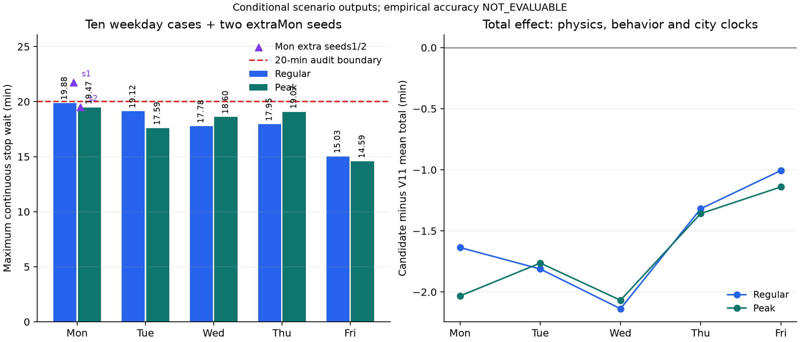
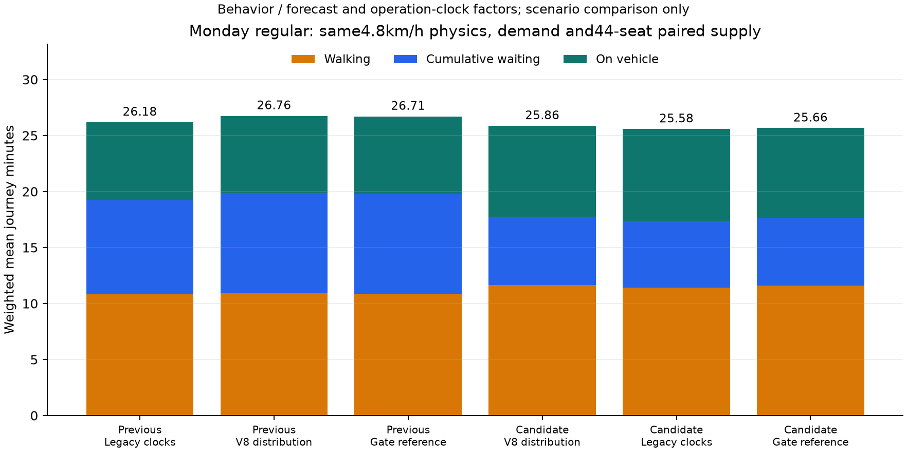

# 무제한 경로 변경 프로토타입 · 검증 결과

작성 2026-11-10T19:48:44+09:00. **주12조건 내부 판정 NEEDS_FURTHER_REPAIR / 추가 도킹참조 실험20분 미충족 / 실측 정확도 NOT_EVALUABLE / 운영 V11 유지.**

## 무엇을 반영했나

변경 횟수의 상한·예산·소진은 없다. 평상시 재검토 성향은0.3^현재 변경횟수로 감소하고, 경과 대기·개인 만차 경험의 스트레스는 별도로 재판단 가능성을 높인다. 평균1회는 할당값이 아니다.0~500m의 기본 도보 상대 고려도는 같고1km 이후 급감한다. 실제 보행 선택률은 소요시간·경사·대안·줄에 따라 달라진다. 같은 노선의 뒤 정류장과 재방문은 낮은 고려도0.08/0.05로 남긴다.

보행4.8km/h·해당 계단 구간의3배 시간 시나리오·분 상당 선호비용·실제 차량별 정원/FIFO·지속적 개인차·사건별 확률 선택을 분리한 프로토타입이다. 도보 선호계수2를 실제 도보시간2배로 쓰지 않는다. 실제 이동시간과 일반화비용을 구분하며 이미 기다린 시간을 잔여 ETA에 다시 더하지 않는다.

기존 수강 기반 출발자료·목적지 참고비중·보행망을 동결했다. 같은 출발지·시각·목적지의 가중 통행을 재배분하며 실제 학생 명부나 개인별 목적지를 관측한 자료가 아니다. 표시 점·고유 학생·가중 통행·승차·재차·대기 방문은 서로 다르다.

총시간의 종점은 모형의 설입·낙성대·대학동·기숙사 거점이다. 개인 집까지의 연결 시간은 별도 미확보다. 윗공대 표는301·302동 출발에서 서울대입구역 도착까지로 종점을 일치시켰다.

행정관→설입 주간44명/차와 가정한15~19시 피크 창의 두 대 묶음 공급을 양쪽에 똑같이 사용했다. 두 차량을88명 단일 버스로 바꾸지 않았다. 다른 차량의 참고 정원과 야간60명 미확인 가정은 유지했다. 실제 공급을 늘려20분을 맞추지 않았다.

## 검증 범위와 판정

월~금×regular/peak10조건과 월요일regular seed1/2를 포함한 **12조건**을 검산했다. 이미 통과한 부모 목요일peak seed0은 코드·설정·입력·감사 해시를 확인해 재사용했고11조건은 새로 계산했다. 최대 연속 정류장 대기는 **21.74408분**,20분 초과 가중 대기 사건량은 **0.118735**, 미완료 통행량은 **0.000000**이다.

주 기준은11:20~23:10에 겹치는 모든 연속 대기 방문이다. 줄을 떠나 걷거나 다른 정류장으로 간 방문도 포함한다. 같은 줄에서 호환노선을 바꾸어도 시계를 초기화하지 않는다. 창 밖 초기화 기록까지 포함한 최대는21.74408분,20분 초과량은0.118735이다.20분 강제 이탈·대기 자르기·수요 삭제는 하지 않았다.

이는 유한 조건과 난수의 내부 검사다. 모든 난수·현실의 모든 날에20분 이하라는 보장이나 실측 정확도 향상 판정이 아니다. 실제 정답이 부족하므로 NOT_EVALUABLE을 유지한다. 새 사용자 명시 승인 전 V11·latest·사이트 기본 모형·경로 앱 입력을 교체하지 않는다.

별도 민감도인 정문 도킹 절대시계 참조에서는 최대20.28958분,20분 초과0.639341명 상당·회가 남았다. 주 운행시계는 이 결과를 보기 전에 사용자 요청에 따라 V8분포로 고정했으며, 추가 실험까지 모두 통과한 것은 아니다. 어떤 운행변동에서도20분 미만이라는 견고성을 확보했다고 주장하지 않는다.

## 요일·배차별 전체 비교

분 단위 평균은 분석창 밖 출발도 포함한 같은 전체 입력 부모 통행을 양쪽에 사용한다. 대기 최대의 분석창 기준과 분모가 다르다. 아래는 보행 물리시간·행동/예측·시내버스 운행시계를 함께 바꾼 V11대비 전체 효과다.

|요일·공급|총시간 평균 V11→후보|누적 대기 V11→후보|도보 V11→후보|최대 연속 대기 V11→후보|20분 초과|미완료|창 뒤 완료|
|---|---:|---:|---:|---:|---:|---:|---:|
|월 regular|27.50→25.86|8.85→6.08|11.55→11.65|16.594→19.875|0.00000|0.00000|0.00000|
|화 regular|27.39→25.58|8.77→6.05|11.40→11.22|17.264→19.125|0.00000|0.00000|0.00000|
|수 regular|27.83→25.69|9.04→6.02|11.61→11.58|16.918→17.775|0.00000|0.00000|0.00000|
|목 regular|26.75→25.43|8.36→5.96|11.18→10.99|16.561→17.945|0.00000|0.00000|0.11370|
|금 regular|20.10→19.09|4.66→3.81|8.12→7.35|15.969→15.031|0.00000|0.00000|0.00000|
|월 peak|27.25→25.22|8.69→5.82|11.49→11.42|16.594→19.470|0.00000|0.00000|0.00000|
|화 peak|27.08→25.32|8.59→5.95|11.29→11.07|18.142→17.590|0.00000|0.00000|0.00000|
|수 peak|27.53→25.46|8.86→5.84|11.52→11.53|17.517→18.602|0.00000|0.00000|0.00000|
|목 peak|26.46→25.11|8.19→5.87|11.11→11.01|16.561→19.075|0.00000|0.00000|0.11370|
|금 peak|20.05→18.91|4.61→3.71|8.12→7.30|15.969→14.589|0.00000|0.00000|0.00000|

전 정류장990행과 도착시각 기준30분 집계12070행을 만들었다.30분 표는 그 구간에 줄에 도착한 방문의 최종 연속 대기이며 순간 줄 길이와 다르다. 기존검증CSV의max_queue는 전체기록최대이므로 [시각범위 대조990행](queue_peaks_by_window.csv)에서 분석창/창밖을 구분한다.

[요일 비교 CSV](weekday_comparison.csv) · [전 정류장 CSV](../prototype_validation_261110190402/all_stops_waits.csv) · [30분 CSV](../prototype_validation_261110190402/half_hour_waits.csv) · [12조건 감사 JSON](../prototype_validation_261110190402/validation.json).

## 윗공대301·302동 → 서울대입구역

같은301/302동 출발·설입 목적지의 부모 통행만 양쪽에서 골랐다. 줄에서 빠져나가 걷거나 다른노선으로 바꾼 통행을 포함한다. 가중치가 실제 고유 학생수라는 뜻은 아니다.

|요일·공급|입력 가중통행|누적 대기 V11→후보|도보 V11→후보|총시간 V11→후보|
|---|---:|---:|---:|---:|
|월 regular|1093.25|6.28→5.22|5.03→5.53|25.22→24.12|
|화 regular|1078.89|6.28→5.53|4.89→5.47|25.16→24.38|
|수 regular|1164.85|5.83→5.29|4.83→5.49|24.66→24.08|
|목 regular|977.22|6.05→5.76|5.24→5.90|25.01→24.94|
|금 regular|193.47|2.98→3.93|3.14→3.72|20.66→21.18|
|월 peak|1093.25|6.13→5.03|5.00→5.56|25.16→23.80|
|화 peak|1078.89|6.16→5.43|4.93→5.50|25.08→24.32|
|수 peak|1164.85|5.74→5.18|4.85→5.50|24.63→23.99|
|목 peak|977.22|5.89→5.65|5.22→5.82|24.95→24.65|
|금 peak|193.47|2.98→4.01|3.14→3.64|20.66→21.13|

[윗공대 요일별 CSV](engineering_snu_weekday_comparison.csv) · [윗공대30분별 CSV](engineering_snu_departure_half_hour_comparison.csv) · [분모·수지 검산](engineering_snu_departure_half_hour_comparison.json). 이30분은 수업 종료자료에 기초해 생성한 모형 통행출발시각(plan[4], 원래departure[particle]) 기준으로, 정류장 도착시각 기준인 전정류장30분 표와 다르다. 공식 수강편람 종료시각의 원표나 실제 학생 하교시각의 관측으로 해석하지 않는다. 같은시간구간의 부모 질량과 요일별 평균이 일치하는지 양쪽 감사에서 검산했다. 이전CSV의class_end_bin_* 이름만 바로잡았고 수치·모형은 바꾸지 않았다.

## 추가 난수와 변경 횟수

|조건|최대 연속 대기|20분 초과량|변경 평균|총시간 평균|
|---|---:|---:|---:|---:|
|월 regular seed1|21.7441|0.118735|1.0732|25.614|
|월 regular seed2|19.4964|0.000000|1.0936|25.820|

월요일regular seed0의 실제 변경 횟수 분포: 0회 47.71%, 1회 22.83%, 2회 14.00%, 3회 8.82%, 4회 3.60%, 5회 1.42%, 6회 0.90%, 7회 0.41%, 8회 0.28%, 9회 0.02%, 10회 0.00%, 11회 0.00%, 12회 0.00%. 모든12조건의 분포는 감사JSON에 보존했다. 같은seed라도 서로 다른 알고리즘의 모든 난수 호출까지 같다는 뜻은 아니다.

## 21분 사례를 어떻게 고쳤나

앞선R7의12조건 중 목요일peak에서21.07310분/가중0.0548006 통행이 남았다.17:12시점 재구성에서는 앞줄이0이고, 과거 최소여석0.137명 상당을 다음차에 확실히 있는 것으로 취급해 작은 가중 통행은 탈 수 있다고 예측했다. 그 다음차의 실현된 모형 여석은0이었다. 실제 현장의 탑승 정답을 재현한 것은 아니다.

앞사람이5513을 거절해도 예측에서는 줄이 청산되는 일반 구조의 불일치도 검토했지만, 이 시점의 앞줄0 재구성에서는 특정 실패의 원인으로 지지되지 않았다. 원래 가설과 반증·수정된 해석을 모두 보존했다.

선택 예측에서 작은 가중 대표 통행도 개인 요청량 최소1로 조회하고, 여러 차량의0.x석을 누적해 탄 것으로 계산하지 않게 했다. 앞줄은 기존 가중 FIFO 예측으로 먼저 처리한다.2.1석−앞줄1.05=1.05석이면 한 사람의 요청이 가능해야 하므로 앞줄 처리 전 정수 내림은 하지 않는다. 실제 가중 질량·정원·부분 승차·FIFO·준비20초·대기시계·선호와 변경 위험률은 그대로다.

정수 내림을 포함했던R8은 단일 조건의 보수 민감도 실험으로 보존하고 결과를 보기 전에 방법상의 이유로 주 후보에서 제외했다. 현재 최소수정R9는30개 경계 검산과 독립 정적 검토를 거쳤다. 과거 여석만으로 다음차 여석을 보장할 수 없으므로 이는 보수적 개인 선택 시나리오이며 실측 탑승확률·정확한 ETA의 입증이 아니다.

[앞선R7 전체 실패·수정 보고서](../prototype_review_2026-11-10/RESULTS.md) · [실패 시점 재구성](../prototype_validation_261110182218/thu_queue_forecast_replay.json) · [최신 좌석단위 검토](../collaboration/r7_queue_clearance_review_261110182218/SEAT_UNIT_ADDENDUM.md) · [현재코드 독립정적검토](../collaboration/r9_static_review_261110185755/READ_ONLY_REVIEW.md).

## 행동/예측과 운행시간의 요인 비교

같은4.8km/h 물리시간·수요·44명/두대 공급·seed0의 월요일regular 비교다. 이전행동 대조는R1의 검증 완료 결과를 재사용했다. V8분포가 주 운행보정이며gate_reference는 정문 도킹 절대시각의 별도 참조다. 월요일 자료를 다른요일에 전이한 것은 가정이다. 시내 구간 진입시각별 시간을 쓰고 정차시간을 다시 더하거나 셔틀 시계에 복사하지 않았다.

|행동/예측|운행시계|누적 대기|도보|총시간|최대 연속 대기|20분 초과량|
|---|---|---:|---:|---:|---:|---:|
|previous|baseline|8.456|10.810|26.183|16.7621|0.00000|
|previous|distribution_v8|8.949|10.925|26.758|17.2001|0.00000|
|previous|gate_reference|8.955|10.870|26.707|17.2067|0.00000|
|candidate|distribution_v8|6.081|11.645|25.864|19.8755|0.00000|
|candidate|baseline|5.949|11.433|25.581|18.4703|0.00000|
|candidate|gate_reference|6.009|11.606|25.661|20.2896|0.63934|

[요인 비교6행 CSV](behavior_operations_comparison.csv). 같은 공급 시나리오끼리 행동/예측 효과를 비교해야 한다. 임의의 가장 잘 맞는 시계나 초를 선택하지 않았다.

[추가 도킹참조 실패 상세](additional_clock_diagnostic.json)에는 대학원생활관21897의 두 가중 통행을 보존했다.11:05도착→11:25탑승으로 분석창에 겹쳤고, 이전 변경2회·만차1회·자발적 승차거절0회였다. 이후에도 재검토했으므로 횟수 소진이 아니다. 첫 차량은 다른 승객으로 만차가 됐고 두번째 차량에 탔다. 버스가 가까워진 뒤 기다리는 비용이 도보보다 낮게 나왔으며 실제 현장 원인으로 확인된 것은 아니다.20분 경보를 남기고 늦은 도보 전환이나 임의 공급증가로 지우지 않았다.

## 기존 줄 관측 네 건과의 진단

모두 기존 선택 또는 공급 정정에 사용한 자료이며 독립 검증이 아니다. 초 미상은1분 안의 균등 임의시점으로 놓고 정확히 시간적분했다.17:03과11/10의 같은 처리는 비교 가정이다. 날짜는 대화일에서 추정했고 문화관입구21297의 방향 매핑은 미확정이다. 서울대학교21128설입방향은 사용자 확인값이다.

|보고|줄|V11→후보 분내 평균|V11→후보 기대 절대오차|
|---|---:|---:|---:|
|mon 16:53 행정관|53|42.74→86.88|13.16→33.88|
|mon 16:55 문화관입구|5|4.57→0.06|0.53→4.94|
|mon 17:03 서울대학교|33~39|37.92→15.15|1.12→17.85|
|tue 15:23 행정관|67|89.43→156.49|22.43→89.49|

네 보고 중4건에서 후보의 기대 줄 오차가 더 컸다.33~39를 정확한36명으로 바꾸지 않고 보고구간까지의 거리를 썼다. 아래 비교로 새 정확도 향상을 주장하지 않으며 이 결과에 계수를 다시 맞추지 않았다.

[regular/peak·다른시계 전체22행 CSV](known_queue_diagnostic.csv) · [정의·원본/감사 해시](known_queue_diagnostic.json). 개인189초·탑승후30초는 한 사건이다. 사진 두 장이나67명을 독립 대기 표본으로 늘리지 않았다. 전역 모형의 도착·승차·출발은 한 사건 근사이므로 개인189초를 도착대기/승차처리로 분리 재현했다고 하지 않는다.

## 도보와 전체 이동의 꼬리

한 정류장의20분 기준과 여정 누적 대기·귀가 총시간은 다르다. 줄에서 걸어 나간 통행을 포함하고, 같은 원래 부모 통행 전체의 가중 분위수를 비교했다. 미완료를 완료로 숨기지 않았으며 창 뒤 완료량은 앞 표에 분리했다.

|요일·공급|도보 p99 V11→후보|누적 대기 p99 V11→후보|총시간 p99 V11→후보|총시간 최대 V11→후보|
|---|---:|---:|---:|---:|
|월 regular|38.18→42.66|47.11→24.92|84.78→71.84|129.82→122.14|
|화 regular|38.29→42.47|46.58→26.17|83.54→71.27|136.63→147.43|
|수 regular|38.85→44.94|47.83→25.34|86.75→73.17|134.25→127.57|
|목 regular|37.02→42.22|44.10→23.83|81.14→70.79|101.33→98.16|
|금 regular|22.00→19.52|19.27→14.25|44.10→45.00|55.53→68.03|
|월 peak|38.25→44.13|47.14→23.31|85.34→68.16|129.82→120.51|
|화 peak|38.12→42.52|46.73→27.35|83.81→77.20|136.63→174.99|
|수 peak|38.97→44.48|48.01→25.51|87.04→73.97|134.25→143.68|
|목 peak|36.97→43.43|44.13→24.97|81.18→69.87|101.33→135.15|
|금 peak|22.00→19.52|19.27→14.22|43.98→45.24|55.53→68.03|

[모든 분위수·변경횟수40행 CSV](journey_tail_comparison.csv) · [감사 해시와 수지](journey_tail_comparison.json). 드문 장거리 보행·반복 변경·긴 총시간은 별도의 모형 품질 대상이다. 연속 대기만 통과했다고 자연스러운 행동이나 운영 준비 완료로 판정하지 않는다.

## 줄 길이 참고와 시간대별 병목

서울대정문·법대/사회대입구 두방향×요일×배차40셀 중 분석창 최대줄이40명 상당을 넘는 셀은7개다. 약40명은 사용자 기억의 참고값이며 측정된 상한이 아니다. 줄을40명으로 잘라 맞추지 않았다. 다음표는 각방향에서 가장 큰 분석창 줄이며 전체기록 최대는별도CSV에 보존했다.

|정류장·ARS|조건|분석창 최대줄|최대시각|
|---|---|---:|---:|
|서울대정문 21269|화 regular|18.56|17:00|
|서울대정문 21299|월 regular|125.28|13:07|
|법대.사회대입구 21270|화 peak|50.83|17:05|
|법대.사회대입구 21298|월 regular|61.44|14:03|

[40셀 원표](named_stop_queue_review.csv) · [990셀 분석창/전체시각 대조](queue_peaks_by_window.csv).R7에서61.36명 상당은11:05로 분석창 전,50.37은21:00으로 분석창 안이었다. [R7개별 줄 수지](../prototype_review_2026-11-10/law_queue_service_detail.json)는 유입·승차·도보이탈과 차량통과·거절을 분리한 사후 모형 장부이며 실제 현장 원인 증거는 아니다.

30분별 전체 원표에서 최대대기와 총대기노출(평균대기×도착가중치)을 나눠 봐야 한다. 작은 가중 통행의 긴 대기와 많은 통행의 짧은 대기는 다른 병목이다. [30분 CSV](../prototype_validation_261110190402/half_hour_waits.csv)에는 승차자와 중도이탈 방문이 함께 들어 있다.

총대기노출이 큰 상위10셀은 다음과 같다. 각 행은 별도 요일·공급 시나리오이고, 여러행의 가중 방문을 합쳐 고유 학생수로 부르면 안 된다. 시간대는 정류장 도착 기준이다.

|요일·공급|정류장·ARS|도착 구간|방문 가중치|평균 대기|최대 대기|가중 대기 합계(명 상당×분)|
|---|---|---|---:|---:|---:|---:|
|수 peak|서울대학교 21128|12:30~13:00|734.77|4.81|10.58|3532.44|
|목 peak|서울대학교 21128|12:30~13:00|641.73|4.93|10.17|3164.45|
|수 regular|서울대학교 21128|12:30~13:00|708.25|4.45|10.58|3150.74|
|월 peak|서울대학교 21128|12:30~13:00|715.26|4.30|10.58|3075.91|
|목 regular|서울대학교 21128|12:30~13:00|625.72|4.74|9.90|2966.31|
|화 regular|행정관 |17:00~17:30|504.16|5.74|11.85|2891.61|
|화 regular|서울대학교 21128|12:30~13:00|655.63|4.39|12.70|2875.90|
|목 regular|행정관 |15:00~15:30|677.64|4.21|10.69|2849.55|
|목 peak|행정관 |15:00~15:30|701.57|4.02|9.53|2818.80|
|화 peak|서울대학교 21128|12:30~13:00|729.90|3.77|11.70|2748.63|

[모든30분셀·가중대기노출 CSV](half_hour_wait_exposure.csv). 이 순위는 실측 혼잡순위가 아니라 모형의 비교 지표다.

후속 검증 대상은 수업종료 도착집중과 차량 도착위상, 같은 목적지의 다른 노선·교내 셔틀 연결, 하류에 도착하기 전 차내 재차, 실제 승하차 체류다. 공급을 바꿀 때는 차량 총량·정원을 맞춘 별도 실험으로 효과를 분리해야 한다. 혼잡등급을 임의 인원으로 바꾸거나 관측 승차를 정류장 도착수요로 덮어쓰지 않는다.

## 검산·남은 한계·운영 경계

부모별 질량·성향 지속·보행시간·시간 분해·실제 승하차와 재차 수지·정원·자발거절을 구분한 적격FIFO·준비전 취소·대기열 재구성·차량시각을 감사자료로 별도 검산했다.30개 경계검사는 같은시각44명 두차량, 준비중 놓친차, 소수석 여러차량 누적불가, 앞줄처리후1석, 변경100회후 재검토 가능 등을 포함한다.

실제사건과 여행자의 예측이 같은 고정 외생 공급시계를 공유한다. V8추정 시계는 공식 공개 시간표가 아니며 실시간 예측 검증이나 미래정보 완전차단을 통과했다고 표현하지 않는다. actual_schedule/perceived_schedule/available_at분리가 남는다. 승차/대기 뒤 거절·만차일 때 도보를 검토하는 두단계 선택이며 마지막버스보다 빠른 도보의 동시비교·내생적 조기하차는 미구현이다.

일반적인 적격pool과 예측 승차의향의 차이, 경로 유사성, 교외 배경 승객, 경사 누락과 실제 투입 차종 정원이 불확실하다. 선호·위험률·보행 계수는 미보정 시나리오다. 별도44명 두차량 승하차 작은모형의1296민감도 실험은 전역 네트워크에 아직 결합하지 않았다.

미사용 날짜의 정렬된 실제 줄·개인대기·승하차·총시간이 부족하다. 서울시 일별 승하차와 월별 시간대 합계를 날짜×시간의 대기 정답으로 만들지 않았다. 현재 자료로 실측 정확도와 교체 적합성을 판정할 수 없어 NOT_EVALUABLE이다.

운영은 [V11지도](https://snu-shuttle-simulation.vercel.app/)와 [경로앱](https://snu-route-lab.vercel.app/)을 유지한다. 활성모델261110162302, payload SHA256 `f39be2fbe61185f198ac27da9b8b57565cccfb80824e0a4f8f65f68915cbd130`이다. 모바일 지도와44명/피크두대 공급 설명의 운영 변경은 이 행동 프로토타입과 별개다. **새 사용자 명시 승인 전 교체·예약배포·latest변경은 없다.**

출처와 원리: [이전9파일럿의 직접 확인한 출처](../prototype_model_2026-11-10/RESULTS.md#참고한-원리와-직접-확인한-출처), [R7의 모든 실패와 반례](../prototype_review_2026-11-10/RESULTS.md), [현재30검사 로그](../prototype_followup_261110185755/boundary-tests.log), [코드·입력·결과 요약JSON](review.json).

후보 `prototype_followup_261110185755` / 전체검증 `prototype_validation_261110190402`. 모든 이전엔진·원본수요·V7~V11·실패후보·부분실행·실패로그를 보존했다.
