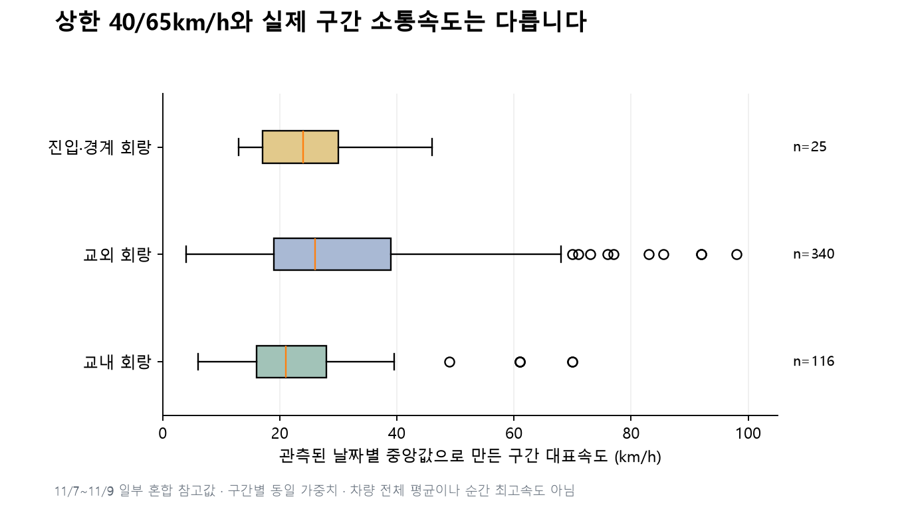

# 교외 진입 혼잡과 관측 도로속도 참고판

할루시네이션 방지 O · 2026학년도 2학기 서울대학교 산업공학과 산업공학의 이해 7조

교내 학생의 하교 편의를 평가하려면 이미 타고 들어온 승객과 실제 도로 통행상태를 함께 고려해야 합니다. 이 참고판은 **관측 도로속도를 실제 구간시간에 적용한 재계산**입니다. 외부 승객의 숫자까지 보정된 완성 혼잡모형은 아닙니다.

## 1. 어떤 관측을 사용했는가

2026-11-07 토요일19:45~23:10, 11-08 일요일11:20~23:10, 11-09 월요일11:20~15:41의 보관 자료를 사용했습니다. 차량 위치·제공시각 관측45,861행과 별도로 저장된 서울시 구간 소통속도45,374개를 구분했습니다. 모두 같은 제공기관의 반복 수집이며 독립 표본 수가 아닙니다.

노선ID·원문 정류장 순번으로 연결한 관측 구간은481개입니다. 저장된 날짜마다 구간속도의 중앙값을 먼저 계산하고, 그 날짜 대표값들의 중앙값을 참고 속도로 썼습니다. 평일·주말과 일부 날짜가 섞인 참고 시나리오이며 요일·시간별 정확도를 입증한 예측모형이 아닙니다.

| 도로 분류 | 관측 연결 구간 | 구간 대표속도들의 중앙값 |
| --- | --- | --- |
| 교내 정류장 회랑 | 116 | 21.0 km/h |
| 교외 회랑 | 340 | 26.0 km/h |
| 진입·경계 회랑 | 25 | 24.0 km/h |

이 중앙값은 구간들을 같은 비중으로 비교한 값입니다. 모든 버스의 평균속도나 순간 주행속도가 아닙니다. 도로 분류도 속도모형의 교내 정류장 회랑 규칙이며 실제 토지 경계의 정밀 측량 결과가 아닙니다.

## 2. 시뮬레이션에 어떻게 적용했는가

기존 v5도 일부 저장 구간속도를 이미 사용했습니다. 이번에는 새 보관 자료로 시내버스 모형의271개 구간 참고값을 갱신했고, 그중137개 구간의 통행시간이 달라졌습니다. 경로 방향·양 끝 위치·길이·도로 형상이 맞는40개 셔틀 구간에는 공통도로 참고값을 연결했습니다. 그중18개 구간의 시간이 달라졌습니다. **셔틀 자체의 실측 운행속도는 아닙니다.**

교내40·교외65km/h와 가감속은 주행모형의 상한·제약으로 유지합니다. 구간시간은 관측 참고속도로 만든 시간과 가감속·정차 제약 시간 중 큰 값입니다. 정차15초를 다시 더하지 않았습니다. 정류장 근처 관측 간 통과시간57,102쌍도 만들었지만, 요일·시간을 일치시키면 기존 기준인5표본·2개 날짜를 만족하는 셀이 없어 실제 완료 통행시간 모형으로 승격하지 않았습니다.

관측하지 못한 정차 성격·셔틀 전용 구간·전체 교외 노선 중 모형 진입 전 시계는 기존 가정이 남습니다. 특히 이 참고판은 시간대별로 속도를 바꾸는 모형이 아니라, 보관 날짜들의 통합 구간 참고값을 적용한 실험입니다.

월~금·기준/피크 배차10개 조건을 같은 수업·보행 집단으로 재실행했습니다. 새 도착시각에 맞춰 차량 공유정원·환승·FIFO·경로 변경·대기량을 다시 계산했습니다. 독립 검산은10개 조건의 질량 보존·차량 정원·FIFO·시간대 통계·지도 재생 대응을 통과했습니다. 이는 현실 예측 정확도가 검증됐다는 뜻은 아닙니다.

## 3. 교외에서 이미 타고 온 사람은 어떻게 다루는가

기존 모형의 외부 재차 미포함은 검토가 필요한 구조적 한계입니다. 정류장 도착 전 차내 잔류 인원은 교내 학생이 쓸 수 있는 용량을 줄이므로, 진입 시점의 배경 부하를 별도 경계조건으로 두어야 합니다.

현재 위치·차량·방향 관측으로7개 교내 진입/후문 기준 구간과3개 교외 정문 승차 접근 구간을 따로 집계했습니다. 다음은 월요일 낮의 진입 기준 순번 관측입니다. 같은 차량의 반복 방문이 포함되며 각 지점의 표본이 달라 전후 표를 단순 차감할 수 없습니다.

| 노선·방향 | 진입 기준 관측 지점 | 관측 방문 | 여유3 | 보통4 | 혼잡5 | 미제공0 |
| --- | --- | --- | --- | --- | --- | --- |
| 5511 → 중앙대학교 | 서울대학교 | 17 | 17 | 0 | 0 | 0 |
| 5511 → 대학동고시촌입구 | 서울대학교 | 26 | 7 | 18 | 1 | 0 |
| 5513 → 서울대학교 | 서울대학교 | 19 | 5 | 9 | 5 | 0 |
| 5516 → 노량진역 | 서울대학교 | 11 | 11 | 0 | 0 | 0 |
| 5516 → 대학동고시촌입구 | 서울대학교 | 13 | 11 | 2 | 0 | 0 |
| 관악02-1 → 서울대신공학관 | 서울대후문.연구공원 | 18 | 0 | 0 | 0 | 18 |
| 관악02-2 → 행정관 | 서울대후문.연구공원 | 2 | 0 | 0 | 0 | 2 |

5513 서울대학교 방향에서는 진입 기준19개 방문 중 혼잡5가5개 있었습니다. 교외에서 들어오는 버스가 늘 빈 차라는 근거는 없습니다. 그러나 이 등급을 곧바로 특정 승객 인원으로 바꾸지는 않았습니다. 관악02는 미제공0이며, 관측된 총혼잡에는 교내에서 탄 사람도 포함될 수 있어 전체 관측값에 교내 모형 인원을 다시 더하면 중복됩니다.

정류장별 잔여용량의 기본 관계는 `참고 정원 - 하차 후 남아 있는 기존 승객`입니다. 배경 부하와 교내에서 이미 탄 부하를 분리해 같은 차량의 순차 하차·승차에 연결해야 합니다. 회차하면 전원이 내린다고 가정하거나, 교외 탑승자를 모두 비학생으로 분류하지 않습니다. 이번 속도 참고판의 수치 계산에는 **외부 배경 승객 인원을 아직 넣지 않았습니다.**

## 4. 현재 자료의 한계와 출처

- 평일18시 이후와 화~금 관측이 없어 저녁 하교 정확도를 검증할 수 없습니다.
- 실측 대기 시작·실제 탑승 결과가 없으므로 대기시간 오차MAE/WAPE를 산출하지 않았습니다.
- 제조사 참고 정원50/24는 실제 노선별 투입 차종의 확인된 정원이 아닙니다.
- 관측 등급은 입석을 포함한 차내 혼잡입니다. 빈 좌석 수·승차 가능한 인원과 동일하지 않습니다.
- 원래 v5와 기존 대기모델 릴리스는 그대로 보존합니다. 이 참고판은 새 속도 조건의 별도 실험이며, 경로 추천 앱의 기존 대기모델을 자동 교체하지 않습니다.

[서울시 버스위치정보 API](https://www.data.go.kr/data/15000332/openapi.do)는 위치·시각·구간순번·혼잡등급을 설명합니다. [서울대 공식 교통 안내](https://snu.ac.kr/about/gwanak/transportation/public)는 교내를 경유하는 노선을 안내합니다. [서울시의 혼잡도 설명](https://news.seoul.go.kr/traffic/archives/508221?listPage=1)은 등급의 질적 의미를 설명하지만, 이 보고서에서 현재 차량별 등급을 인원으로 바꾸는 정량 경계로 사용하지 않았습니다.
