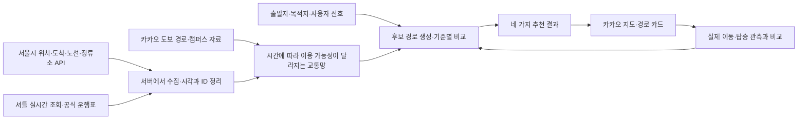

할루시네이션 방지 O

# 서울대 하교길 최적화 프로젝트: 어떤 API를 왜 사용하는가

**산업공학적 문제해결 과정을 적용한 대중교통 의사결정 지원 시스템**  
용도: 팀원·발표 청중에게 설명하기 위한 API 활용 계획  
확인 기준일: 2026년 11월 4일

첨부된 4페이지 PPT 구성안의 순서에 맞춰 정리했습니다. 발표의 주요 목적지는 **서울대입구역과 낙성대역**이며, 출발 범위는 관악캠퍼스 전역입니다. ‘실제로 조회한 정보’, ‘앞으로 연동할 API’, ‘팀이 직접 추정·검증할 정보’를 구분합니다.

> 저희는 지도에 버스를 표시하고, 학생의 선호에 맞는 하교 경로를 비교하는 서비스를 만들고자 합니다. 카카오맵으로 지도와 도보 경로를 구성하고, 서울시 API로 버스의 위치·도착예정·혼잡도를 가져옵니다. 학교 셔틀 정보까지 연결한 뒤, 저희가 직접 이동시간과 도보 부담, 환승 횟수를 계산해 대안을 추천합니다. 착석 가능성과 수업 종료에 따른 혼잡은 추가 관측으로 검증하며 발전시킬 계획입니다.

---

## 1페이지. 프로젝트 소개 — 서비스 구현에 필요한 API

### 왜 여러 API를 결합해야 할까요?

이 프로젝트에는 **공간 정보**, **운행 정보**, **의사결정 모델**이 함께 필요합니다. 지도는 건물과 정류소의 위치를 보여주고, 교통 API는 움직이는 차량과 도착예정 정보를 제공합니다. 개인의 선호와 학교 셔틀까지 반영한 경로 비교는 이 자료들을 연결해 저희가 구현합니다.

### 제안하는 API 구성

| 구성 요소 | 사용할 API·자료 | 얻는 정보 | 필요한 이유 |
|---|---|---|---|
| 지도 화면 | **카카오맵 지도 Web SDK** | 배경지도, 위치 표시, 경로선과 클릭 기능 | 학생이 출발지와 승차 위치, 추천 경로를 이해하도록 돕습니다. |
| 도보 이동 | **카카오맵 도보 경로 조회 API** | 보행 경로, 거리, 예상 소요시간 | 건물에서 정류소까지, 하차 후 역 출입구까지 걷는 시간을 계산합니다. |
| 버스 위치·차량 혼잡 | **서울시 버스위치정보조회 서비스** | 차량별 좌표, 제공시각, 혼잡도, 만차 표시 | 어느 버스가 접근 중인지와 제공되는 차량의 혼잡 상태를 확인합니다. |
| 버스 대기시간 | **서울시 버스도착정보조회 서비스** | 정류소·노선별 도착예정 정보 | 사용자가 정류소에 도착한 뒤 탈 수 있는 버스를 찾습니다. |
| 교통망 구조 | **서울시 노선정보조회·정류소정보조회 서비스** | 노선, 경유 순서, 정류소 위치, 배차간격·운행시간 등 | 정류소와 노선을 연결하고 승차 방향과 환승 가능성을 판단합니다. |
| 학교 셔틀 | **BUSIN 실시간 웹 조회 인터페이스 + 공식 운행표** | 조회되는 셔틀 차량 정보, 노선·정차 순서·운행시간 | 일반 지도 서비스에 학교 셔틀이 반영되는지 확인하고, 빠진 연결을 직접 구성합니다. |
| 캠퍼스 내부 정보 | **서울대 공식 캠퍼스맵·확인된 출입구 자료** | 건물 번호, 출입구, 교내 이동시설 | 같은 건물이라도 실제 출입구에 따라 달라지는 보행 경로를 보완합니다. |

카카오맵은 지도 SDK와 도보 경로 조회를 공식 문서로 제공하므로 우선 연동 후보로 제안합니다. 현재 카카오 키로 지도를 띄우거나 교내 보행 경로를 검증한 단계는 아닙니다. [카카오 지도 SDK 안내](https://apis.map.kakao.com/web/guide/), [카카오맵 REST API](https://developers.kakao.com/docs/ko/kakaomap/rest-api)

서울시의 네 서비스는 목적이 서로 다릅니다. 위치 API는 차량 상태, 도착 API는 기다릴 시간, 노선·정류소 API는 연결 구조를 담당합니다. [버스위치정보](https://www.data.go.kr/data/15000332/openapi.do), [버스도착정보](https://www.data.go.kr/data/15000314/openapi.do), [노선정보](https://www.data.go.kr/data/15000193/openapi.do), [정류소정보](https://www.data.go.kr/data/15000303/openapi.do)

출발지는 건물 검색이나 지도 핀으로 입력받습니다. ‘내 위치’를 선택하는 경우에는 사용자의 허용을 받아 **브라우저 Geolocation API**를 사용할 수 있습니다. 학생의 현재 위치를 받는 기능과 버스의 위치를 받는 기능은 별개입니다. [W3C Geolocation 명세](https://www.w3.org/TR/geolocation/)

---

## 2페이지. 문제 정의 및 분석 — 어떤 불확실성을 줄일 수 있는가

### ① 도착시간과 대기시간의 불확실성

등록된 배차간격은 노선의 기본정보입니다. 현재 정류소에서 얼마나 기다려야 하는지는 **실제 도착예정 정보와 사용자의 정류소 도착시각**을 함께 봐야 합니다.

실제로 11월 4일 16:51에 조회했을 때, 5511의 배차간격 응답은 7분이었습니다. 그러나 유회진학술정보관·제1공학관 정류소의 다음 두 버스는 각각 10분 56초 후와 20분 54초 후로 예측됐습니다. 두 버스의 예상 도착 간격은 **9분 58초**였습니다. 이 값도 예측이며, 실제 통과 간격은 별도로 관측해야 합니다.

근거: [당시 위치·배차·도착예정 대조 기록](bus_api_2026-11-04/snapshot_20261104_165101_379169/AVAILABLE_DATA.md).

따라서 ‘배차간격이 짧은 노선’을 고르는 것에 더해, **내가 정류소에 도착한 뒤 가장 먼저 탈 수 있는 차량**을 비교합니다.

### ② 혼잡도와 착석 가능성의 불확실성

| 구분 | 현재 이용 가능한 정보 | 직접 단정할 수 없는 정보 |
|---|---|---|
| 차량 혼잡 | API가 제공하는 여유·보통·혼잡 등급, 만차 표시 | 정류소에서 기다리는 인원, 정확한 빈 좌석 수 |
| 탑승 가능성 | 접근 차량, 도착예정, 만차 여부를 판단의 보조자료로 활용 | 줄의 위치까지 반영한 탑승 성공 확률 |
| 착석 가능성 | 차량 혼잡 상태를 참고자료로 표시 | ‘이 버스에서 앉을 확률 80%’와 같은 수치 |

**편안한 경로는 초기에는 제공되는 혼잡 정보를 기준으로 비교하고, 착석 확률은 실제 탑승·착석 관측을 확보한 뒤 예측합니다.** 혼잡 등급 하나를 임의의 착석 확률로 바꾸지 않습니다.

또한 모든 노선이 같은 정보를 주는 것은 아닙니다. 실제 확인한 관악02-1·02-2의 위치 API 응답에서는 혼잡도가 ‘정보 없음’이었습니다. 별도의 도착예정 웹 응답에는 재차인원 항목이 있었지만, 이를 혼잡 등급이나 잔여 좌석으로 혼동하지 않습니다.

### ③ 여러 대안을 비교하는 부담

현재는 학생이 서로 다른 화면에서 버스, 셔틀, 도보 경로를 확인해야 합니다. 저희 서비스는 이 정보를 하나의 경로 카드에 모아 **총 이동시간·도보거리·환승 횟수·제공되는 혼잡 정보·자료 기준시각**을 함께 보여줍니다. 이를 통해 반복적인 정보 탐색과 비교 부담을 줄이는 것이 목표입니다.

---

## 3페이지. 산업공학적 문제해결 방법 — API 데이터를 의사결정으로 연결하기

### 1. 교통 시스템을 네트워크로 구성합니다

| 네트워크 요소 | 구성 방법 | 사용하는 정보 |
|---|---|---|
| 노드 | 건물 출입구, 방향별 정류소, 역 출입구 | 캠퍼스맵, 정류소 좌표, 확인된 장소 위치 |
| 도보 간선 | 걸어서 이동 가능한 두 지점을 연결 | 도보 경로의 거리·예상시간, 교내 통로 확인 |
| 버스·셔틀 간선 | 정차 순서에 따라 정류소를 연결 | 노선정보, 셔틀 운행표, 실제 운행·도착 정보 |
| 환승 연결 | 하차 지점에서 다음 승차 지점으로 이동 | 보행시간, 다음 차량 도착예정, 운행시간 |

같은 이름의 맞은편 정류소와 순환노선에서 반복되는 정류소를 구분해야 합니다. 따라서 **노선 ID·정류소 ID·노선 내 정차 순번**을 함께 사용합니다. 그래야 반대 방향 버스나 이미 지나간 정차 구간을 추천하는 오류를 줄일 수 있습니다.

### 2. 걷는 동안 버스도 움직인다는 점을 반영합니다

경로의 총시간은 다음 항목으로 나눠 계산합니다.

**총 이동시간 = 모든 도보시간 + 모든 정류소 대기시간 + 모든 차내 이동시간 + 별도로 필요한 승하차 여유시간**

환승 도보와 환승 대기는 각각의 합계에 포함합니다. 같은 시간을 ‘환승 시간’이라는 이름으로 다시 더하지 않습니다.

1. **출발지에서 후보 정류소까지 걸리는 시간을 계산합니다.** 사용자가 도착하기 전에 떠나는 버스는 탈 수 없기 때문입니다.
2. **정류소 도착 이후 이용 가능한 버스·셔틀을 찾습니다.** 현재 화면에 보이는 첫 버스만 고르면 실제로 놓치는 연결이 생길 수 있기 때문입니다.
3. **차내 이동과 하차 후 보행까지 합산합니다.** 버스에서 내리는 시점과 역 출입구에 도착하는 시점은 다르기 때문입니다.
4. **사용자의 평가 기준에 따라 대안을 비교합니다.** 가장 빠른 경로와 가장 적게 걷는 경로가 서로 다를 수 있기 때문입니다.

이 과정의 후보 생성·시간 계산·선호 반영은 저희가 구현하는 모델입니다. 외부 길찾기 API는 도보 경로와 일반 대중교통 경로 등을 제공할 수 있지만, 학교 셔틀과 자체 혼잡 예측까지 통합한 비교는 별도로 검증해야 합니다.

### 3. 확정적 구조와 확률적 추정을 결합합니다

노선의 정차 순서와 연결 관계는 네트워크의 기본 구조로 사용합니다. 대기시간·주행시간의 변동은 반복 관측을 모아 추정하고, 같은 조건에서 예상값과 실제 이동시간을 비교합니다. 실시간 도착예정값도 확정된 미래 시간으로 취급하지 않습니다.

| 추천 유형 | 평가할 지표 | 초기 구현과 검증 방향 |
|---|---|---|
| **최단시간 경로** | 보행·대기·차내 이동을 합한 총시간 | 탈 수 있는 차량을 기준으로 계산하고 실제 도착시간과 비교합니다. |
| **편안한 경로** | 제공되는 차량 혼잡 정보, 이후 검증한 착석 가능성 | 초기에는 혼잡 정보를 표시합니다. 착석 확률은 관측자료가 생긴 뒤 추가합니다. |
| **최소도보 경로** | 전체 도보거리, 추후 확인한 경사·계단 부담 | 거리부터 비교하고 교내 경사·통로 자료를 보완합니다. |
| **최소환승 경로** | 차량을 갈아타는 횟수 | 환승이 같은 대안에서는 이동시간 등 다른 지표를 함께 비교합니다. |

카카오 도보 API는 거리·예상시간·경로 좌표를 제공합니다. 그러나 이 응답만으로 관악캠퍼스의 모든 계단과 경사 부담이 검증됐다고 말할 수는 없습니다. 필요한 구간은 공식 캠퍼스 자료와 현장 관측으로 대조합니다. [도보 API 명세](https://developers.kakao.com/docs/ko/kakaomap/rest-api), [서울대 캠퍼스맵](https://map.snu.ac.kr/web/main.action)

### 4. 확장 분석: 수업 종료에 따른 정류소 유입

수업 종료시각·강의실 위치를 확보하면, 해당 건물에서 정류소까지 걸어오는 시간을 고려해 유입 가능성을 분석할 수 있습니다. 이 부분은 **최신 강좌 자료와 보행 정보가 필요한 추가 분석**입니다. 현재 확인된 공개 수업 API가 있다고 가정하지 않고, 학교가 제공하는 자료의 확보 방법을 먼저 확인합니다.

수업 종료 인원이 모두 같은 목적지로 하교하거나 버스를 타는 것은 아닙니다. 따라서 ‘종료 강좌의 수강인원 합계’, ‘정류소 도착 예상’, ‘실제 승차 인원’을 구분합니다. 현재 보유한 7월 3일 기준 수강편람은 8,008개 강좌의 수강신청인원이 전부 0이므로 현재 혼잡 수요를 계산하는 자료로 사용할 수 없습니다. [공개 편람 출처](https://gsep.snu.ac.kr/boards/notice/41324/detail/news/notice/?page=1&paginate_by=10), [최신 강좌 조회](https://sugang.snu.ac.kr/)

---

## 4페이지. 향후 계획 및 기대 학습 효과 — 연동부터 검증까지

### 현재 어디까지 확인했는가

| 항목 | 확인 상태 | 다음 과제 |
|---|---|---|
| 서울시 버스 위치 OpenAPI | 인증키 보관·재사용 및 실제 호출 성공. 11월 4일 16:51에 우선 검증 노선 5개에서 차량 43건 수신 | 캠퍼스 경유 노선의 전체 범위 확정, 누락·지연 확인 |
| 도착예정·배차·정차 순서 | 서울시 공식 모바일 웹 조회로 실제 응답 확보 | 정식 도착·노선·정류소 OpenAPI의 별도 활용승인·호출 검증 |
| 셔틀 실시간 조회 | BUSIN 웹 조회에서 실제 응답 확인. 11월 4일 17:40에도 행정관 노선 조회 HTTP 200 확인 | 좌표 의미, 정류소 대응, 재이용·호출 조건 확인 |
| 지도·도보 API | 카카오 공식 명세와 무료 조건 확인 | 해당 계정의 무료 적용 앱 확인, 키 준비, 실제 지도·교내 보행 경로 검증 |
| 착석 확률·정류소 대기열 | 예측에 필요한 실측자료 미확보 | 실제 탑승·착석·잔류 인원의 비식별 관측 |
| 통합 서비스 | 계획·일회성 수집 단계 | 지도 구현, 경로 계산, 반복 검증 |

우선 검증한 노선은 **5511·5513·5516·관악02-1·관악02-2**입니다. 차량 43건은 해당 노선 전체의 반환값이며, 교내 차량 수나 서울대 경유 전체 노선 수를 뜻하지 않습니다.

근거: [서울시 실제 수집 기록](bus_api_2026-11-04/snapshot_20261104_165101_379169/manifest.json), [셔틀 재조회 기록](api_report_evidence_2026-11-04/busin_probe_receipt.json). 이 문서를 외부에 공유할 때 실제 검증 자료도 제시하려면 해당 자료 폴더를 함께 제공하면 됩니다. 인증키 원문은 이 자료에 포함하지 않습니다.

### Agile 방식의 반복 개발

| 단계 | 구현할 내용 | 완료 여부를 판단하는 기준 |
|---|---|---|
| 1. 기본 지도·데이터 연결 | 건물·정류소·버스 표시, 셔틀 노선 대응 | 위치·방향·기준시각이 일치하고 미확인 정보를 구분하는가 |
| 2. 기본 경로 비교 | 도보·시내버스·셔틀·환승 후보 구성 | 걸어서 도착하기 전에 출발하는 차량을 추천하지 않는가 |
| 3. 네 가지 추천 | 시간·혼잡·도보·환승 기준별 대안 표시 | 각 추천 이유가 실제 데이터와 계산으로 설명되는가 |
| 4. 현장 검증·개선 | 예상시간과 실제시간, 탑승·착석 결과 비교 | 오차·누락을 기록하고 개선 전후를 같은 기준으로 비교하는가 |

검증에서는 최종 도착시간 오차, 정류소 도착예정 오차, 경로 연결 오류, 정보 누락률을 우선 확인합니다. 착석 예측을 도입한 뒤에는 실제 착석 여부와 예측값도 평가합니다. 아직 측정하지 않은 시간 절약률이나 예측 정확도를 성과로 제시하지 않습니다.

Notion은 요구사항·의사결정 기록, GitHub는 코드·이슈·리뷰, Slack은 진행 공유에 활용할 수 있습니다. 초기 교통 서비스 구현에 이들 도구의 API 연동까지 필수인 것은 아닙니다. 먼저 자료 수집, 지도·경로 구현, 현장 검증, 문서화의 역할과 책임을 나누고 변경 이력을 남깁니다.

이를 통해 산업공학의 모델링·최적화뿐 아니라, **업무의 가시성, 역할과 책임, 지식의 공유와 축적, 반복적인 프로세스 개선**을 실제 프로젝트에서 경험하고자 합니다. 이는 첨부 PPT가 제시한 『강소기업, 성장통을 넘다』와의 연결 지점입니다.

---

## 운영 준비: 무료 범위와 데이터 관리

### 카카오 무료 제공량은 조건부로 적용됩니다

| 항목 | 공식 문서의 무료 제공량 |
|---|---:|
| 지도 Web SDK | 일 300,000건 |
| 도보 경로 조회 | 일 1,000건 |
| 전체 API 월간 쿼터 | 월 3,000,000건 |

개발자 계정에서 카카오맵을 **처음 활성화한 앱**에 무료 쿼터가 적용됩니다. 신규 앱을 만들기 전에 기존 앱의 무료 쿼터 배지를 확인해야 합니다. 일간·월간 한도를 함께 검토하고, 한도를 넘기면 계속 무료라고 가정하지 않습니다. [공식 쿼터](https://developers.kakao.com/docs/ko/getting-started/quota), [무료 적용 조건](https://developers.kakao.com/docs/ko/kakaomap/common)

서울시 버스위치 API의 승인 화면에는 확인한 상세기능별 일일 트래픽 1,000이 표시돼 있었습니다. 따라서 갱신 주기는 호출 예산에 맞춰 정하고 필요하면 증액 조건을 확인해야 합니다. 사용자가 화면을 열 때마다 제공기관을 중복 호출하는 방식보다 서버에서 공통 자료를 수집해 공유하는 구성을 제안합니다. 장기 보관과 캐시는 제공기관별 이용 조건을 확인해 적용합니다.

### 셔틀 연동에서 별도로 확인할 점

BUSIN에서 확인한 것은 **웹페이지가 사용하는 조회 인터페이스**입니다. 정식으로 문서화된 공개 OpenAPI와 구분하며, 지속적인 재이용과 호출 조건은 제공기관에 확인해야 합니다.

현재 확인한 셔틀 x/y는 노선도 화면에서 쓰이는 좌표입니다. 이를 위경도로 바로 지도에 표시하지 않습니다. 지리 좌표를 받을 수 있는지 확인하고, 없으면 정류소·운행 구간과 대응시켜 정확도 범위를 표시합니다. [셔틀 운영사 노선 선택 화면](https://sites.google.com/dongyeongtour.co.kr/snu/route), [확인한 BUSIN 행정관 노선 화면](https://web.busin.co.kr/BuslineCircleS.aspx?cd=snu_1&di=41841&tab=F)

### 인증키와 정보의 기준시각

서울시 수집 키와 카카오 REST API 키는 서버에서 관리합니다. 지도 Web SDK에는 해당 JavaScript 키를 사용하고 허용 도메인을 등록합니다. 실제 키를 발표자료·공개 저장소·일반 로그에 넣지 않습니다. [지도 SDK 키·도메인 설정](https://apis.map.kakao.com/web/guide/)

모든 실시간 정보에는 제공시각과 수집시각을 구분해 기록합니다. API가 정상 응답해도 위치가 오래됐거나 혼잡도 값이 없을 수 있으므로, ‘정보 없음’을 ‘여유’나 ‘운행 중단’으로 바꾸지 않습니다.

---

## 기술 부록: 개발 담당자가 먼저 확인할 항목

| 대상 | 핵심 필드·확인 항목 | 해석 원칙 |
|---|---|---|
| 버스 위치 | `vehId`, `gpsX`, `gpsY`, `dataTm` | 차량 식별, 경도·위도, 제공시각을 함께 유지합니다. |
| 차량 혼잡 | `congetion`, `isFullFlag` | 원값과 문서상 의미를 보존하고 승객 수·착석 확률로 임의 변환하지 않습니다. |
| 버스 도착 | 도착예정 메시지·차량 ID·요청 정류소 순번 | 같은 방향과 같은 정차 구간의 정보인지 확인합니다. |
| 노선 기본정보 | `term`, 첫차·막차, 경유 순서 | 등록 배차간격과 현재 대기시간을 구분합니다. |
| 카카오 도보 | `totalDistance`, `totalTime`, 경로 좌표 | 단위는 거리 m·시간 초이며, 교내 경로의 실제 이용 가능성을 대조합니다. |
| 셔틀 | 노선 코드, 차량 식별값, 원 좌표, 응답시각 | 좌표 체계와 코드 의미를 확인하기 전에는 GPS·승객 수로 해석하지 않습니다. |

실제 검증한 버스 위치 요청은 `GET http://ws.bus.go.kr/api/rest/buspos/getBusPosByRtid`입니다. 카카오 도보 API는 공식 명세상 `GET https://dapi.kakao.com/v2/routing/walk`이며, 실제 키를 이용한 호출은 앞으로 검증해야 합니다.

**이 문서에서 제안하는 기본 조합은 ‘카카오맵 지도·도보 + 서울시 위치·도착·노선·정류소 + 학교 셔틀 정보 + 자체 경로 비교 모델’입니다.** 지도와 교통 자료를 연결하는 작업, 착석·혼잡을 예측하는 작업, 추천이 실제로 유용한지 검증하는 작업을 구분해 진행합니다.
